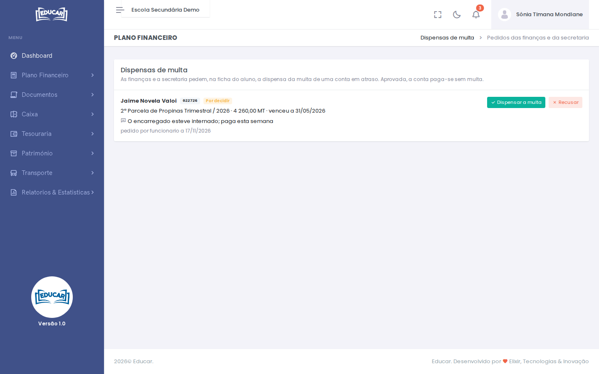

# Dispensas de multa

**Menu:** Plano Financeiro › Dispensas de multa
**Quem vê:** Director financeiro

Os pedidos para não cobrar a multa de uma conta em atraso. As finanças e a secretaria pedem-nos na ficha do aluno; o director financeiro decide.

## Pedir a dispensa (finanças e secretaria)

1. Na ficha do aluno, em **Contas por pagar**, procure a conta em atraso com multa.
2. Na coluna **Multa**, use **Pedir dispensa**, escreva o motivo e use **Pedir**.

A conta passa a mostrar **Dispensa pedida** e o director financeiro recebe um aviso no sino. Só há um pedido aberto por conta.

## Decidir (director financeiro)

Cada pedido mostra o aluno, a conta, o valor, quando venceu, o motivo e quem pediu.

- **Dispensar a multa:** a conta passa a mostrar **Multa dispensada** e paga-se sem multa, por mais que o atraso cresça.
- **Recusar:** escreva o motivo (quem pediu vê-o) e use **Recusar o pedido**. A multa mantém-se.

Em ambos os casos, as finanças e a secretaria recebem um aviso. Uma conta já paga com a multa não se dispensa: recuse o pedido.

Os dias sem multa no início do atraso (a carência) definem-se na [Tabela de Multas](tabela-de-multas.md): basta o primeiro intervalo começar depois do dia 1.
