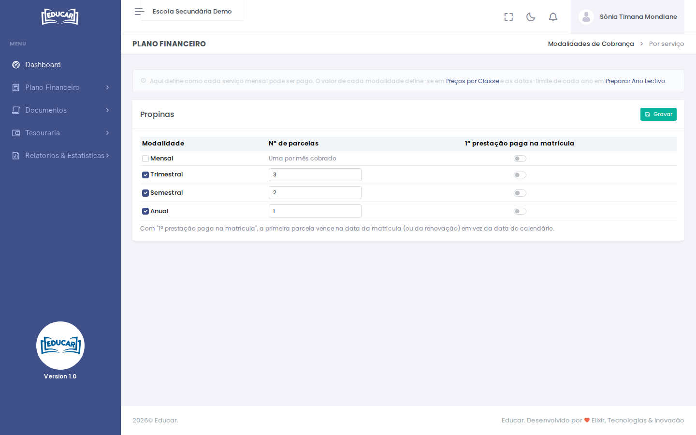

# Modalidades de Cobrança

**Menu:** Plano Financeiro › Modalidades de Cobrança
**Quem vê:** Director financeiro

Como pode ser pago cada serviço mensal (por exemplo, as propinas): mensal, trimestral, semestral ou anual, e em quantas parcelas.

O valor de cada modalidade define-se em [Preços por Classe](precos-por-classe.md) e as datas-limite de cada ano em [Preparar Ano Lectivo](preparar-ano-lectivo.md).

## Configurar

1. Marque as modalidades que a escola aceita.
2. Indique o **Nº de parcelas** de cada uma. Na mensal há uma parcela por mês cobrado.
3. Ligue **1ª prestação paga na matrícula** se a primeira parcela deve vencer na data da matrícula (ou da renovação), em vez da data do calendário.
4. Use **Gravar**.

A modalidade de cada aluno escolhe-se na matrícula e na renovação.
