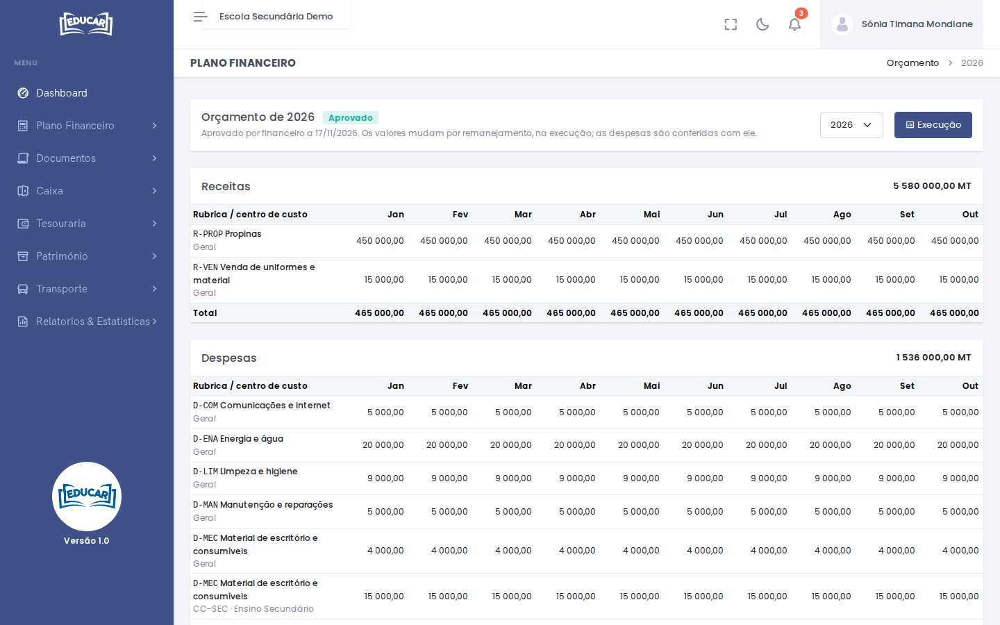
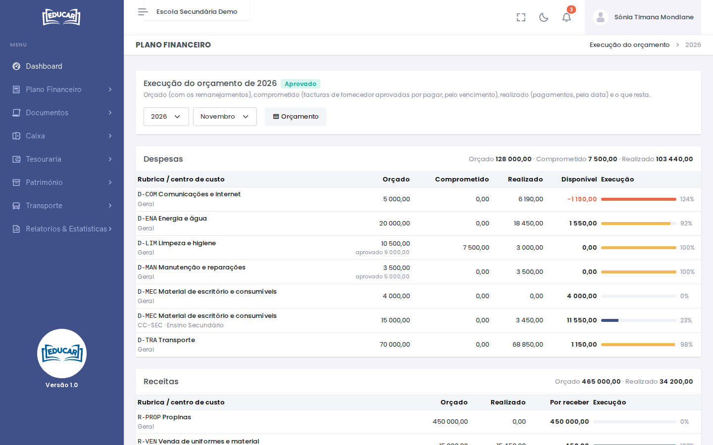

# Orçamento

**Menu:** Plano Financeiro › Orçamento
**Quem vê:** Director financeiro

O orçamento da escola para o ano: quanto se espera receber e gastar em cada rubrica, por centro de custo, em cada mês ou trimestre (como na [Definição financeira](definicao-financeira.md#orcamento)). Depois de aprovado, as despesas são conferidas com ele.

## Criar e preencher

1. Escolha o ano e use **Criar o orçamento**. Pode começar vazio ou copiar o de um ano anterior.
2. Em **Rubrica** e **Centro de custo**, escolha uma linha e use **Juntar a linha**. **Geral (sem centro)** conta tudo o que não tem uma linha própria do centro de custo. As rubricas e os centros são os que a escola usa em [Centros de custo e rubricas](centros-de-custo-e-rubricas.md).
3. Escreva os valores de cada mês (ou trimestre). Vazio é zero.
4. Use **Gravar os valores**. Enquanto está em **Rascunho**, pode mudar tudo e tirar linhas.

## Aprovar

Use **Aprovar o orçamento** (grave antes os valores). Aprovado:

- os valores ficam como **base**; a partir daí só mudam por [remanejamento](#remanejar);
- as despesas passam a ser conferidas com ele (veja [O controlo das despesas](#o-controlo-das-despesas)).

No orçamento aprovado, um valor que mudou por remanejamento mostra por baixo, riscado, o valor aprovado.

## Execução

Use **Execução** para ver, por linha, no ano todo ou num período:

- **Orçado:** o valor actual (com os remanejamentos);
- **Comprometido:** o que falta pagar das [facturas de fornecedores](../tesouraria/contas-a-pagar.md) aprovadas, pelo mês do vencimento;
- **Realizado:** o que se pagou ou recebeu, pela data do pagamento;
- **Disponível** (nas receitas, **Por receber**): orçado menos comprometido menos realizado;
- **Execução:** a percentagem usada. A barra fica amarela acima de 85% e vermelha acima de 100%.

As linhas **Sem orçamento** são rubricas com movimento e sem linha no orçamento.

De onde vem o realizado: os recibos das contas dos alunos (com o desconto e a multa), as vendas ao balcão, as receitas e despesas, os pagamentos das facturas, as despesas do património e os acertos do transporte. A rubrica é a da factura ou a do serviço (veja [Rubrica de cada serviço](centros-de-custo-e-rubricas.md#rubrica-de-cada-servico)); o centro de custo é o da factura ou o escolhido na despesa.

## Remanejar

Para passar orçamento de uma linha e período para outro:

1. Na execução, em **Remanejar**, escolha a origem (**De** e o período) e o destino (**Para** e o período). O destino pode ser uma rubrica que ainda não está no orçamento.
2. Escreva o **Valor (MT)** e o **Motivo**.
3. Use **Remanejar**.

Só se passa até ao disponível da origem. Os remanejamentos ficam listados, com quem os fez e porquê.

## O controlo das despesas

Com o orçamento do ano aprovado, cada despesa é conferida com o disponível da sua rubrica e centro de custo no período:

- **Receitas e Despesas, Despesas do Património, Acertos do transporte:** uma despesa que passa o disponível é recusada, com a mensagem de quanto há. Só o director financeiro a regista; fica em **Despesas acima do orçamento**.
- **Contas a pagar:** uma factura que passa o disponível (pelo mês do vencimento) espera sempre a aprovação do director financeiro, mesmo abaixo do limite de aprovação; o aviso diz quanto há. Aprovada, fica em **Despesas acima do orçamento**. O pagamento de uma factura aprovada não volta a ser conferido.

Sem orçamento aprovado no ano, não há controlo.
