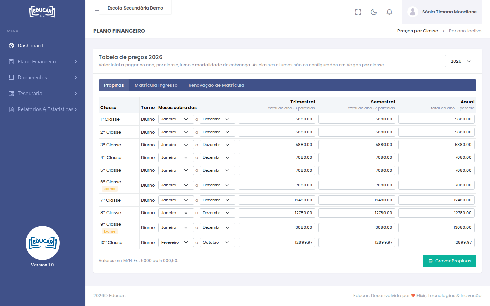

# Preços por Classe

**Menu:** Plano Financeiro › Preços por Classe
**Quem vê:** Director financeiro

O valor total a pagar no ano por cada serviço que varia por classe (propinas, matrícula de ingresso, renovação de matrícula), por classe, turno e modalidade de cobrança.

As classes e turnos são os de [Configurações › Vagas por classe](../configuracoes/vagas-por-classe.md). As classes com exame têm a etiqueta **Exame**.

## Definir os preços

1. Escolha o ano lectivo no canto superior direito.
2. Escolha o serviço nos separadores (por exemplo, **Propinas**).
3. Em cada classe:
    - nos serviços mensais, escolha os **Meses cobrados** (por exemplo, Janeiro a Dezembro);
    - escreva o valor total do ano em cada modalidade (por exemplo, `5000` ou `5 000,50`).
4. Use **Gravar** (por exemplo, **Gravar Propinas**).

O valor de cada modalidade é o total do ano; as parcelas dividem-no. O número de parcelas de cada modalidade está no título da coluna.

!!! tip "Novo ano"
    Para começar um ano com os preços do anterior, use **Copiar preços** em [Preparar Ano Lectivo](preparar-ano-lectivo.md).
