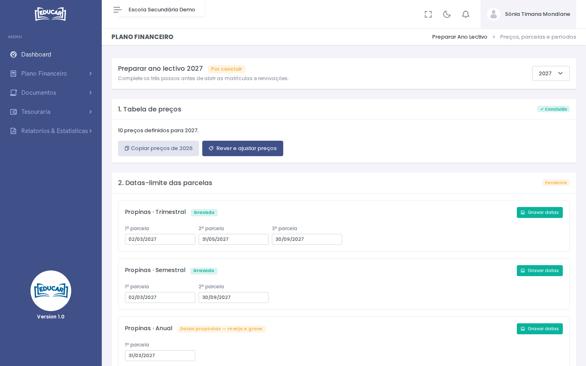

# Preparar Ano Lectivo

**Menu:** Plano Financeiro › Preparar Ano Lectivo
**Quem vê:** Director financeiro

O que o plano financeiro de um ano precisa antes de abrir as matrículas e as renovações. Escolha o ano no canto superior direito. O ano fica **Pronto para matrículas** quando os passos estão concluídos; até lá aparece **Por concluir**.

## 1. Tabela de preços

- **Copiar preços de** (ano anterior) copia a tabela de preços do ano anterior para este.
- **Rever e ajustar preços** abre [Preços por Classe](precos-por-classe.md) neste ano.

## 2. Datas-limite das parcelas

Para cada serviço e modalidade de cobrança (por exemplo, Propinas · Trimestral), a data-limite de cada parcela.

- Quando ainda não foram gravadas, as datas vêm propostas (**Datas propostas — reveja e grave**).
- Ajuste-as e use **Gravar datas**. A modalidade passa a **Gravado**.

As modalidades e o número de parcelas definem-se em [Modalidades de Cobrança](modalidades-de-cobranca.md).

## 3. Períodos de matrícula e renovação

Os períodos de matrícula e de renovação do ano, com o estado de cada um. São definidos pela direcção em [Configurações › Calendário Académico](../configuracoes/calendario-academico.md). O fim de cada período é a data-limite da respectiva taxa.
