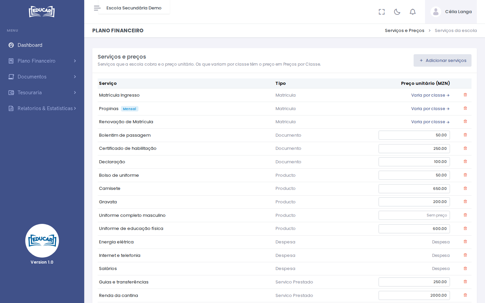

# Serviços e Preços

**Menu:** Plano Financeiro › Serviços e Preços
**Quem vê:** Director financeiro

A lista dos serviços que a escola cobra (matrícula, propinas, documentos, uniformes…) e das despesas que regista, com o preço unitário de cada serviço.

## Adicionar serviços

1. Use **Adicionar serviços**.
2. Escolha os serviços do catálogo.
3. Indique se o **preço varia por classe**, como nas propinas ou na matrícula.
4. Use **Adicionar**.

## Preços

- Serviço com preço único: escreva o preço na coluna **Preço unitário (MZN)**, por exemplo `250` ou `1 250,50`. Vazio quer dizer sem preço.
- Serviço cujo preço **varia por classe**: o preço define-se em [Preços por Classe](precos-por-classe.md).
- As despesas não têm preço.

Use **Gravar preços**. Para tirar um serviço da escola, use o ícone do caixote do lixo.

!!! note "Documentos"
    Cada documento que a escola emite (declaração, certificado…) precisa de preço para se poder pedir. Veja [Pedido de documento](../../processos/pedido-de-documento.md).
