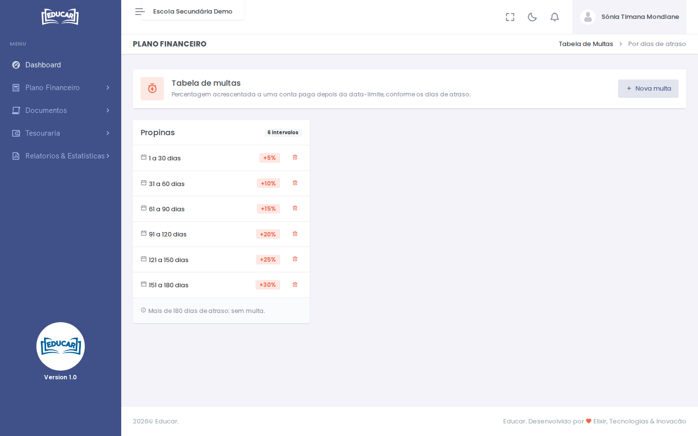

# Tabela de Multas

**Menu:** Plano Financeiro › Tabela de Multas
**Quem vê:** Director financeiro

A percentagem acrescentada a uma conta paga depois da data-limite, conforme os dias de atraso. Sem multas, as contas pagas com atraso cobram só o valor da conta.

## Acrescentar uma multa

1. Use **Nova multa**.
2. Indique o intervalo de dias de atraso (**De** e **Até**) e a **Multa (%)**.
3. Em **Aplicar aos serviços**, marque os serviços. Só aparecem os do plano de pagamento, que têm data-limite; produtos e documentos pagam-se na hora.
4. Use **Gravar multa**.

Cada serviço mostra os seus intervalos. Para lá do último intervalo não há multa, como o cartão indica. Use o caixote do lixo para tirar um intervalo.

A multa aparece na conta do aluno, em [Contas por pagar](../matricula-e-turmas/pesquisar-turma.md#ficha-do-aluno), com a percentagem.
