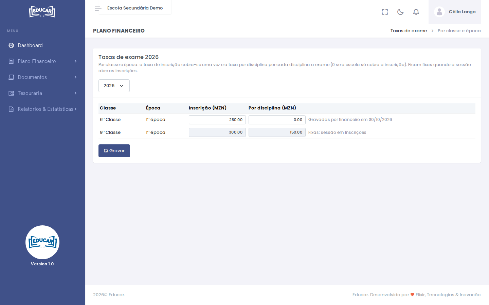

# Taxas de exame

**Menu:** Plano Financeiro › Taxas de exame
**Quem vê:** Director financeiro

As taxas definem-se por ano lectivo, classe e época. A 2ª época pode ter outro preço. Há duas taxas:

- **Inscrição**: cobra-se uma vez por inscrição;
- **Por disciplina**: cobra-se por cada disciplina a exame. Ponha 0 se a escola só cobra a inscrição.

| Exemplo | Inscrição | 4 disciplinas | Total |
|---|---|---|---|
| Só inscrição | 500,00 | — | 500,00 MZN |
| Inscrição + disciplina (150,00) | 300,00 | 600,00 | 900,00 MZN |

1. Escolha o ano lectivo.
2. Preencha as taxas de cada classe e época. Se ainda não houver valores, o ecrã sugere os do ano anterior; grave-os para os usar.
3. Use **Gravar**.

Sem taxas gravadas, a sessão dessa classe e época não abre as inscrições. Quando as inscrições abrem, as taxas ficam **fixas**, porque já há contas de alunos com esses valores.

