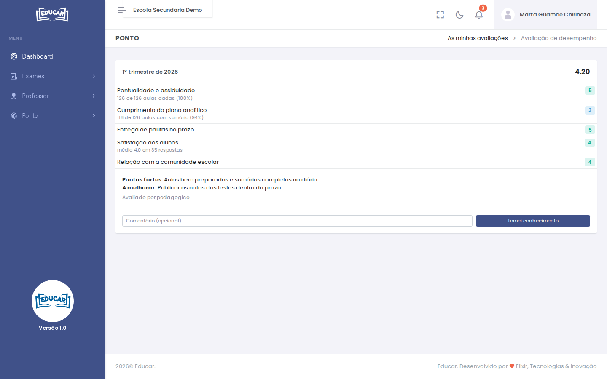

# As minhas avaliações

**Menu:** Ponto › As minhas avaliações
**Quem vê:** Professor

Aqui o docente vê as suas avaliações de desempenho concluídas pela direcção pedagógica. Quando uma é concluída, chega um aviso.

Cada avaliação mostra:

- a nota de cada critério, com o indicador do sistema e a observação;
- os pontos fortes e o que há a melhorar;
- a nota final.

Leia-a, escreva um comentário se quiser e carregue em **Tomei conhecimento**. A direcção vê que a viu e o comentário. Os critérios estão explicados em [Avaliação de desempenho](../recursos-humanos/avaliacao-de-desempenho.md).
