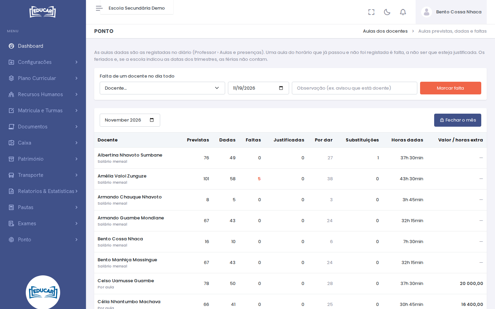
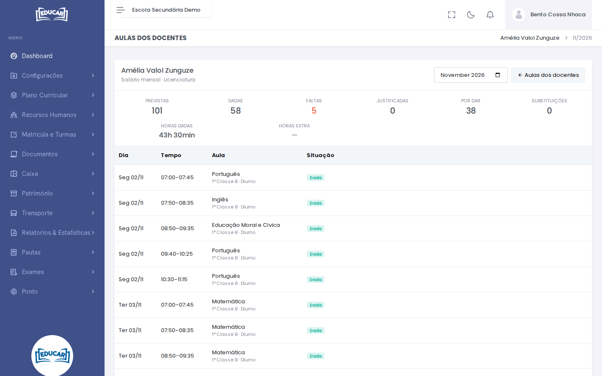

# Aulas dos docentes

**Menu:** Ponto › Aulas dos docentes
**Quem vê:** Chefe da secretaria, Funcionário da secretaria, Director pedagógico, Gestor de recursos humanos, Director da escola

As aulas de cada docente no mês: as previstas no horário, as dadas, as faltas e as substituições, e o valor das aulas de quem é pago por aula. É daqui que saem, no fecho do mês, os números das aulas para a folha de salários.

## Como se contam

- **Previstas:** os tempos do horário de cada turma, nos dias da semana do horário. Não contam os [feriados](../recursos-humanos/definicoes-de-rh.md#feriados) e, se a escola indicou as datas dos trimestres (Configurações › Faltas), os dias fora deles.
- **Dadas:** as aulas registadas no diário pelo docente ([Professor › Aulas e presenças](../professor/aulas-e-presencas.md)).
- **Faltas:** as aulas que já passaram e não foram registadas, e as que a secretaria marcou como falta. **Justificadas:** as faltas justificadas, que não descontam.
- **Por dar:** as aulas de hoje e dos dias seguintes.
- **Substituições:** as aulas que o docente deu em vez de outro.
- **Valor / horas extra:**
    - Para quem é pago **por aula**: as aulas dadas (as suas e as de substituição) vezes o valor do perfil (o nível de ensino da turma e o grau do docente, veja [Definições de RH](../recursos-humanos/definicoes-de-rh.md#perfis-de-valor-por-aula)). Uma aula sem perfil aparece a vermelho.
    - Para quem tem **salário mensal**: as horas dadas acima do limite das horas extra. As horas extra só se pagam depois de aprovadas na folha de salários.

Clique num docente para ver as aulas dele, uma a uma.

## Faltas dos docentes

- **A secretaria marca** a falta: o dia todo (no topo da página, com o docente, o dia e uma observação) ou um só tempo (**Marcar falta** na aula).
- **Só o chefe da secretaria e o director pedagógico justificam** a falta, com o motivo (**Justificar**). Uma aula não registada no diário também se justifica assim.
- **Tirar a falta** (o **x**) corrige uma falta marcada por engano. Uma falta já justificada só a tira quem justifica.
- Nos dias de uma licença aprovada em [Recursos Humanos › Férias e licenças](../recursos-humanos/ferias-e-licencas.md), as aulas do docente ficam justificadas, com a nota **Licença aprovada**.

## Substitutos

Em **Substituto**, escolha o docente que dá a aula em vez do titular. O substituto recebe um aviso e vê a aula nas suas aulas do dia, marcada como **substituição**, para a registar no diário. A aula conta para o substituto (em **Substituições** e, se é pago por aula, no valor) e não para o titular, que fica com a falta (justificada ou não).

## Fechar o mês

No fim do mês, o director pedagógico confere as aulas e usa **Fechar o mês**. Os números de cada docente ficam guardados para a folha de salários, e as faltas, as justificações e os substitutos desse mês deixam de mudar. Para corrigir alguma coisa, o director pedagógico usa **Reabrir o mês** e volta a fechá-lo.
