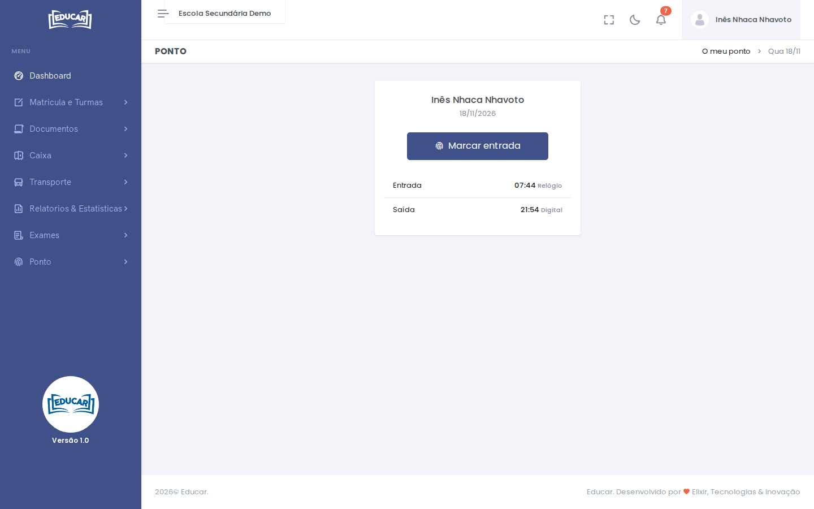

# O meu ponto

**Menu:** Ponto › O meu ponto
**Quem vê:** todo o pessoal da escola com conta

Nas escolas sem relógio biométrico (ou quando o relógio avaria), cada colaborador marca aqui a entrada e a saída.

Use **Marcar entrada** quando chega e **Marcar saída** quando sai. As marcações do dia aparecem por baixo, com a hora. Não se marca duas vezes em menos de 2 minutos.

Se a mensagem diz que não está registado como colaborador, fale com o gestor de recursos humanos: tem de ter a ficha de colaborador e, para contar atrasos e faltas, um horário de trabalho. Os atrasos e as faltas aparecem em [Recursos Humanos › Ponto](../recursos-humanos/ponto.md).
