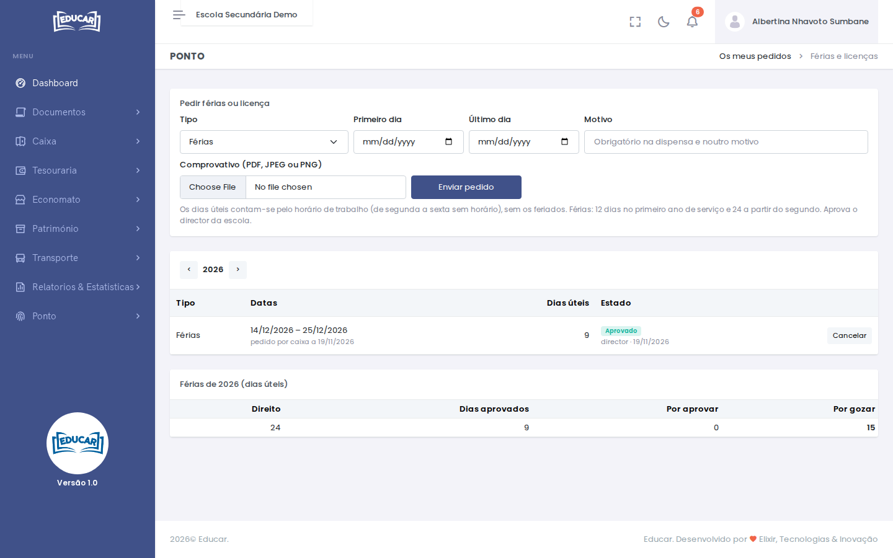

# Os meus pedidos

**Menu:** Ponto › Os meus pedidos
**Quem vê:** todo o pessoal da escola com conta

Aqui cada colaborador pede férias, licenças e dispensas e acompanha a decisão do director da escola.

## Pedir

1. Escolha o **tipo**: férias, licença de maternidade ou de paternidade, doença, luto, dispensa ou outro motivo.
2. Indique o **primeiro** e o **último dia**.
3. Escreva o **motivo**, obrigatório na dispensa e noutro motivo.
4. Junte o **comprovativo** se o houver, por exemplo o atestado médico.
5. Carregue em **Enviar pedido**.

O sistema conta os dias úteis pelo seu horário de trabalho, sem os feriados. As férias são **12 dias úteis** no ano da admissão e **24** a partir do segundo ano. O quadro por baixo mostra quantos dias ainda tem.

Quando o director decide, recebe um aviso. Um pedido aprovado pode ser **sem vencimento**: esses dias descontam no salário.

Pode **cancelar** um pedido que ainda não foi decidido, ou umas férias aprovadas que ainda não começaram.

Se a mensagem diz que não está registado como colaborador, fale com o gestor de recursos humanos. Os pedidos são tratados em [Recursos Humanos › Férias e licenças](../recursos-humanos/ferias-e-licencas.md).
