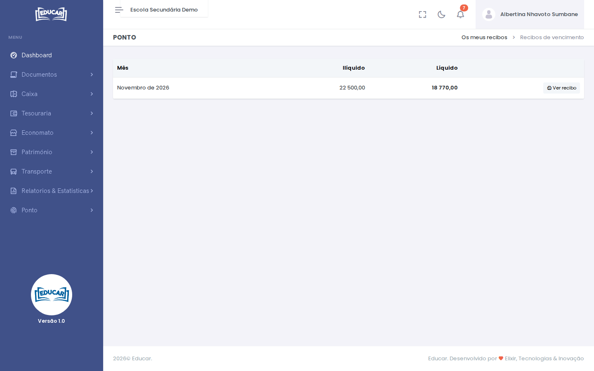
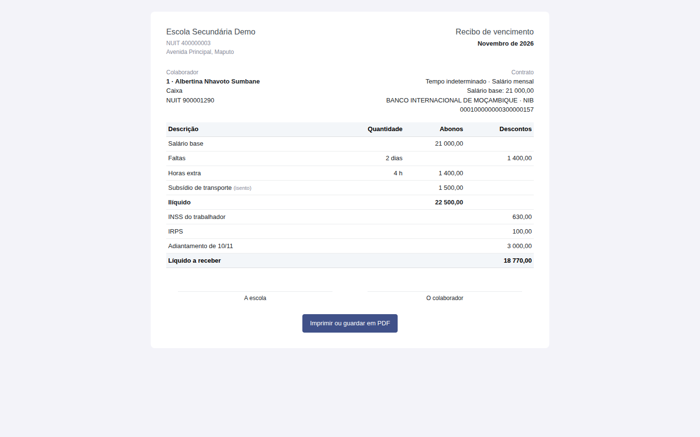

# Os meus recibos

**Menu:** Ponto › Os meus recibos
**Quem vê:** todo o pessoal da escola com conta

Aqui cada colaborador vê os seus recibos de vencimento. O recibo de um mês aparece quando o RH fecha a [folha de salários](../recursos-humanos/folha-de-salarios.md); nesse momento chega também um aviso.

**Ver recibo** abre o recibo, que se pode imprimir ou guardar em PDF.

O recibo mostra:

- o salário base, ou as aulas dadas nos docentes pagos por aula;
- as faltas, as licenças sem vencimento, as horas extra e as horas nocturnas;
- os subsídios e os abonos (os isentos de impostos vêm marcados);
- o ilíquido;
- os descontos (INSS, IRPS, adiantamentos);
- o líquido a receber.

Se há alguma coisa que não está certa, fale com o gestor de recursos humanos.
