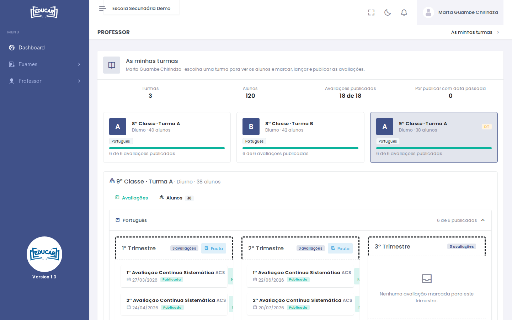

# As minhas turmas

**Menu:** Professor › As minhas turmas
**Quem vê:** Professor

As turmas onde o professor dá aulas este ano. Daqui marca as avaliações, lança e publica as notas.

O topo resume as turmas, os alunos, as avaliações publicadas e quantas estão **Por publicar com data passada**. Cada cartão é uma turma, com as disciplinas que dá e a barra das avaliações publicadas. **DT** quer dizer que é o director dessa turma.

Escolha uma turma. Há dois separadores: **Avaliações** e **Alunos**.

## Marcar uma avaliação

1. No separador **Avaliações**, na disciplina e no trimestre, use **Nova Avaliação**.
2. Escolha o **Tipo de Avaliação** (por exemplo, ACS) e a **Data**.
3. Use **Salvar**.

## Lançar e publicar as notas

1. Abra a avaliação.
2. Escreva a nota de cada aluno (0 a 20) ou marque **Faltou**. Use **Enter** para passar ao aluno seguinte.
3. As notas gravam-se sozinhas enquanto escreve (rascunho): pode sair e voltar. Os alunos ainda não as vêem.
4. Use **Rever antes de publicar**. Vê quantos alunos têm nota, a média, as negativas, as faltas e quem ficou sem nota.
5. Use **Publicar notas**.

Depois de publicadas, os alunos vêem as notas e elas entram nas pautas do trimestre. Enquanto o trimestre estiver aberto, ainda pode corrigir uma nota: a correcção grava-se sozinha e fica logo visível. Com o trimestre encerrado, as notas só se consultam.

**Pauta**, em cada trimestre, abre a pauta trimestral da disciplina, que se pode descarregar em Excel.
