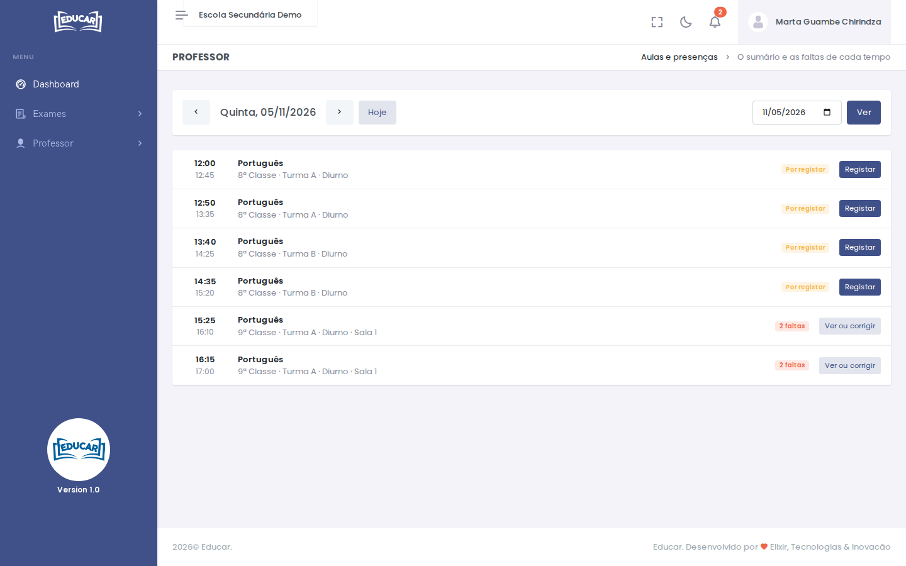
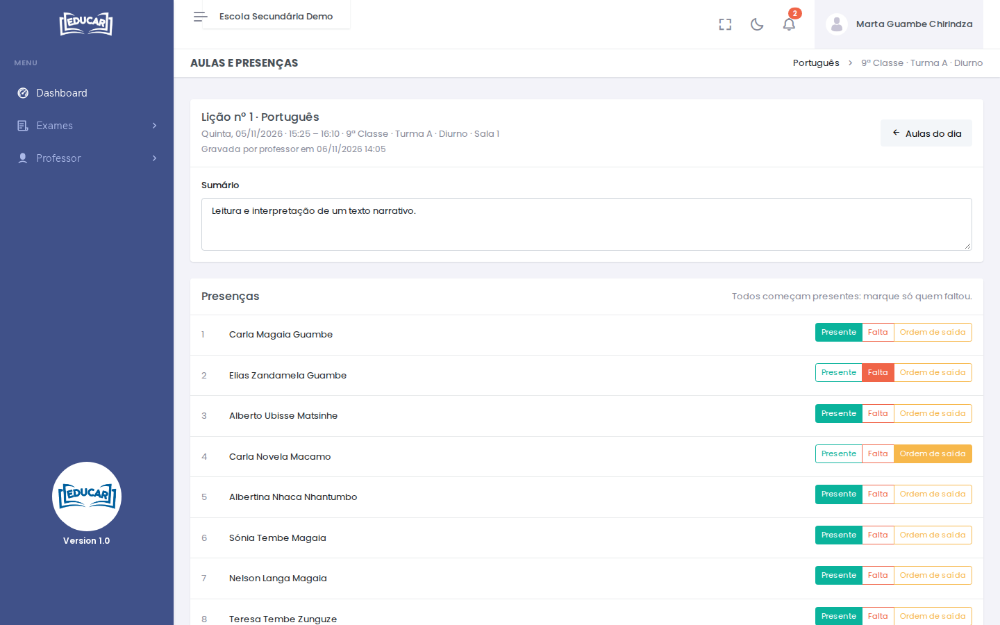

# Aulas e presenças

**Menu:** Professor › Aulas e presenças
**Quem vê:** Professor

Em cada aula, o professor escreve o sumário e marca quem faltou. Cada tempo do horário conta como uma presença: uma aula de dois tempos seguidos são duas presenças.

## As aulas do dia

O ecrã abre no dia de hoje, com os tempos do seu horário. Para outro dia, use as setas ou escolha a data e use **Ver**.

Cada tempo mostra o seu estado:

- **Por registar:** ainda não gravou essa aula.
- **Todos presentes** ou **N faltas:** a aula já está gravada.
- **Sem sumário:** a aula foi gravada sem sumário.

Só se registam aulas de hoje ou de dias anteriores do ano lectivo.

## Registar uma aula

1. Use **Registar** no tempo.
2. Escreva o **Sumário**: o que foi dado nessa aula.
3. Todos os alunos começam **Presentes**. Marque **Falta** em quem faltou, ou **Ordem de saída** em quem saiu da sala por ordem do professor.
4. Use **Gravar**.

O número da lição é automático: conta as aulas já gravadas dessa disciplina na turma.

## Tempos seguidos

Se a disciplina tiver mais tempos seguidos na mesma turma, por exemplo das 12:00 às 13:35, aparece a opção **Gravar o mesmo sumário e as mesmas faltas nos tempos seguidos**. Fica marcada, por isso basta gravar uma vez.

Se um aluno só faltou a um dos tempos, desmarque a opção e grave cada tempo à parte.

## Corrigir

Use **Ver ou corrigir** no tempo, altere e grave de novo. A folha mostra quem a gravou pela última vez e quando.

As justificações que a secretaria já fez mantêm-se, excepto na falta que mudar de falta para ordem de saída, ou ao contrário.

## Avisos

Quando grava faltas, o aluno e os encarregados podem receber um aviso, conforme a [configuração da escola](../configuracoes/faltas.md). Quando um aluno atinge um limite de faltas, o director de turma também é avisado.

Na app, o professor também regista as aulas, quando a app tiver esta área.
