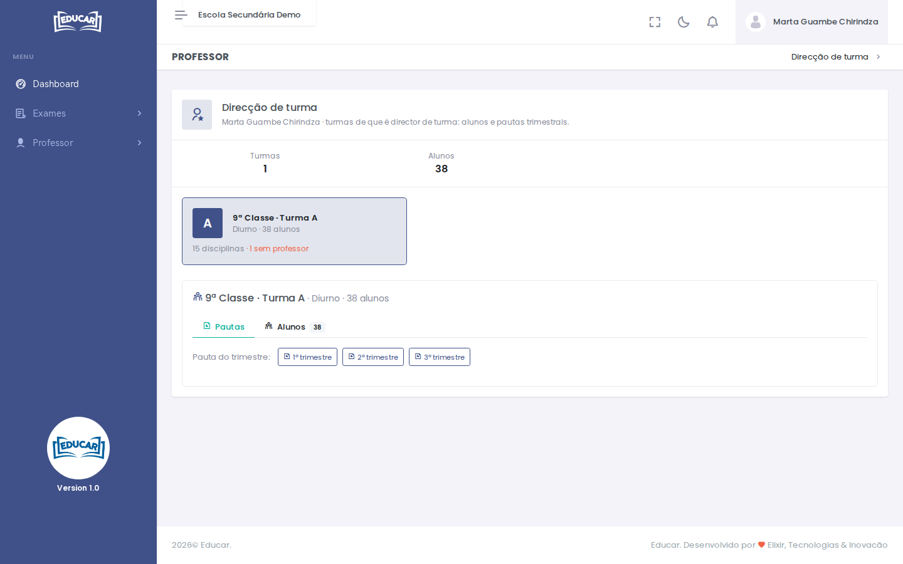
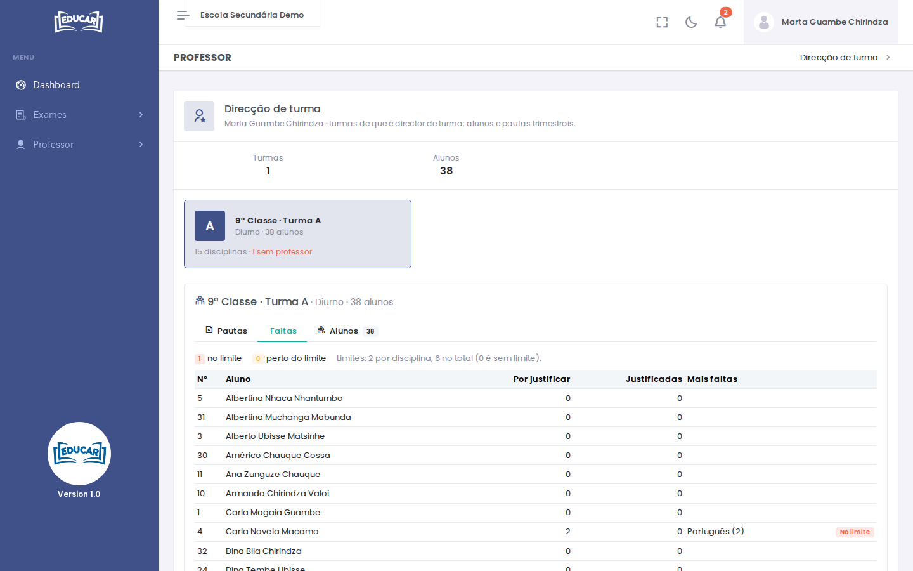

# Direcção de turma

**Menu:** Professor › Direcção de turma
**Quem vê:** Professor

As turmas de que o professor é director de turma este ano: as pautas trimestrais, as faltas e os alunos.

Cada cartão mostra a turma, quantas disciplinas tem e se alguma está **sem professor**. Escolha uma turma:

- **Pautas**: abre a pauta do 1º, 2º ou 3º trimestre da turma, com todas as disciplinas;
- **Faltas**: as faltas de cada aluno, por justificar e justificadas, a disciplina com mais faltas e quem está **Perto do limite** ou **No limite** (veja [Faltas](../configuracoes/faltas.md));
- **Alunos**: a lista dos alunos da turma.

Quando um aluno da turma atinge um limite de faltas, o director de turma recebe um aviso.

A turma aparece aqui quando a direcção indica o professor como director de turma, no horário da turma.
