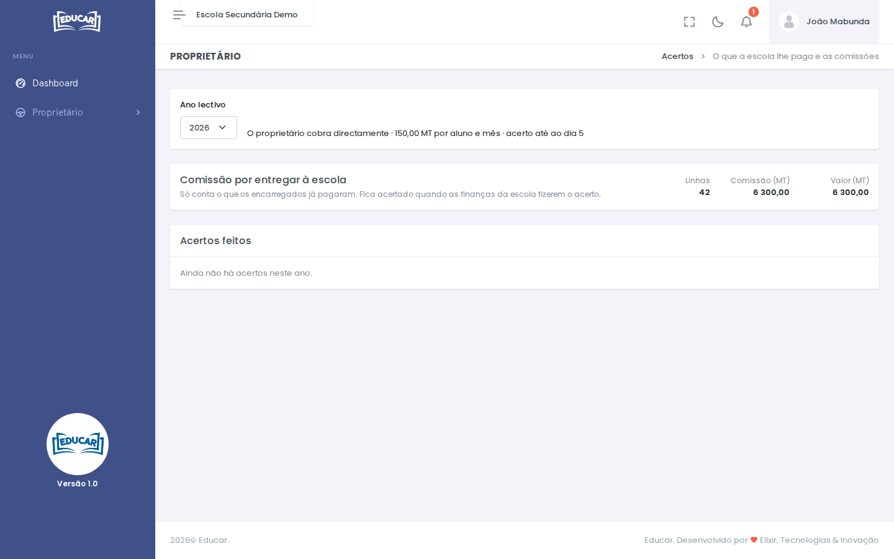
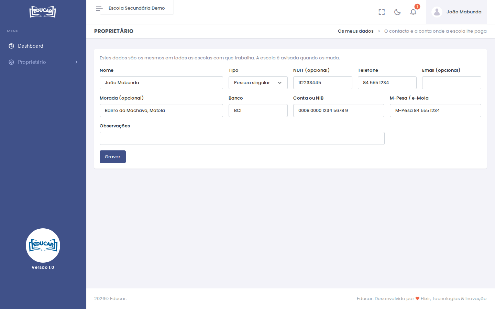

# Acertos e os meus dados

**Menu:** Proprietário › Acertos e Proprietário › Os meus dados
**Quem vê:** Proprietário de transporte

## Acertos

O acordo do ano com a escola e o dinheiro do transporte:

- quando a escola cobra, **Por receber da escola** mostra as mensalidades já pagas pelos encarregados, menos a comissão da escola;
- quando o proprietário cobra, **Comissão por entregar à escola** mostra a comissão de cada aluno e mês.

Fica acertado quando as finanças da escola fazem o acerto, em [Tesouraria › Acertos do transporte](../tesouraria/acertos-do-transporte.md). Em **Acertos feitos**, **Extracto** abre o extracto de cada acerto, em PDF.

## Os meus dados

O nome, o NUIT, o telefone, o email, a morada e onde a escola lhe paga: o banco e a conta ou NIB, ou a carteira M-Pesa / e-Mola. Estes dados são os mesmos em todas as escolas com que trabalha.

