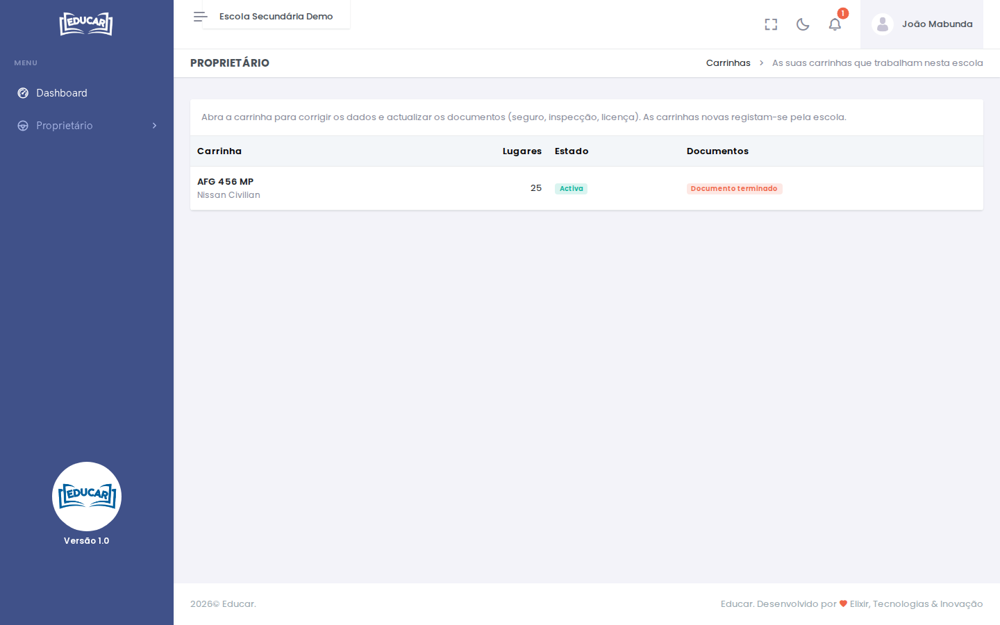
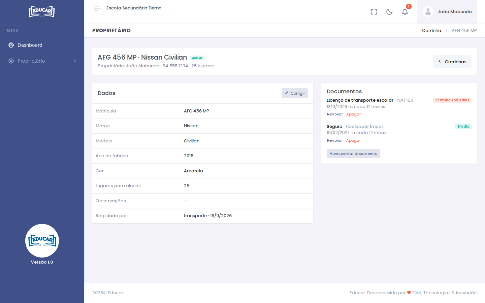
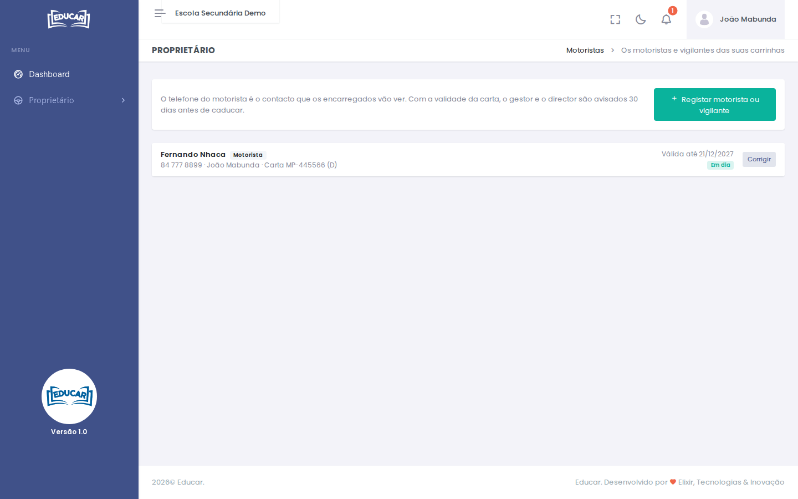

# Carrinhas e motoristas

**Menu:** Proprietário › Carrinhas e Proprietário › Motoristas
**Quem vê:** Proprietário de transporte

## Carrinhas

A lista mostra as carrinhas do proprietário que trabalham nesta escola, com o estado dos documentos. As carrinhas novas registam-se pela escola.

Na ficha da carrinha, **Corrigir** muda a marca, o modelo, o ano, a cor, os lugares e o estado (activa, em manutenção, inactiva). No quadro **Documentos** regista-se o seguro, a inspecção, a licença de transporte escolar e os outros documentos com validade; **Renovar** grava a nova data e **Apagar** retira um documento que já não se aplica.

Quando a carrinha trabalha em várias escolas, os dados e os documentos são os mesmos em todas: uma correcção vale para todas. O proprietário e as escolas recebem os avisos dos documentos a terminar.

## Motoristas e vigilantes

Use **Registar motorista ou vigilante** e indique o nome, a função, o telefone e, no motorista, a carta de condução e a validade. **Corrigir** muda os dados; desligar **No activo** tira a pessoa das rotas novas.

O telefone do motorista é o contacto que os encarregados vêem na app.
