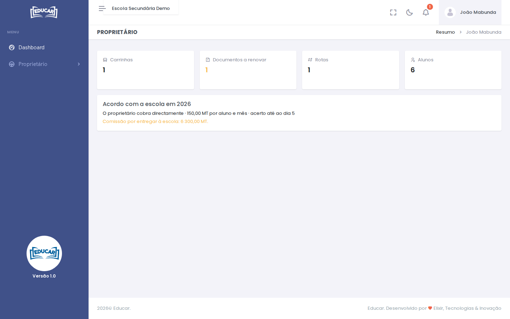

# Proprietário

O menu do proprietário de carrinhas que trabalha com a escola. Mostra só o que é dele nessa escola: as suas carrinhas e os documentos, os seus motoristas, as rotas que as suas carrinhas fazem, com os alunos, e os acertos com a escola.

| Ecrã | O que faz |
|---|---|
| [Resumo](index.md#resumo) | Os números da escola e o acordo do ano |
| [Carrinhas e motoristas](carrinhas-e-motoristas.md) | Os dados das carrinhas, os documentos com validade e os motoristas e vigilantes |
| [Rotas e alunos](rotas-e-alunos.md) | As rotas, as zonas e os preços, os pedidos à escola e as inscrições dos alunos |
| [Acertos e os meus dados](acertos-e-dados.md) | O que a escola paga ou o que se entrega à escola, os extractos, e o contacto e a conta onde recebe |

## Entrar

A conta do proprietário é criada pelo gestor do transporte da escola, em [Transporte › Proprietários](../transporte/proprietarios.md#dar-acesso-ao-proprietario). O proprietário entra com o telemóvel e a senha inicial que lhe dão, e muda-a na primeira entrada.

Quem trabalha com várias escolas tem uma só conta: ao entrar, escolhe a escola. As carrinhas, os motoristas, os documentos e os seus dados são os mesmos em todas as escolas; as rotas, os alunos e os acertos são de cada escola.

Na app do EDUCAR, o proprietário vê as carrinhas, as rotas com os alunos, os pedidos e os acertos, renova documentos, trata dos motoristas e muda as zonas. Criar rotas e inscrever alunos faz-se no site. Ver [A app](../../primeiros-passos/app.md#proprietario-de-transporte).

## Resumo

O primeiro ecrã mostra o número de carrinhas e de documentos a renovar, as rotas e os alunos inscritos nesta escola, o acordo do ano e o acerto por fazer: o que vai receber da escola ou a comissão a entregar.

## A escola é avisada

Cada mudança feita pelo proprietário (dados das carrinhas, documentos, motoristas, os seus dados, rotas, preços e inscrições) chega ao gestor do transporte da escola.
