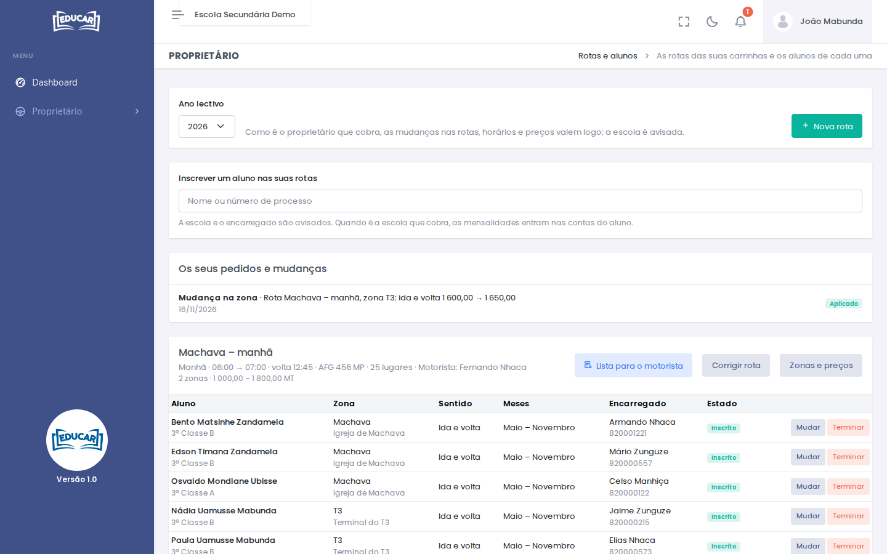
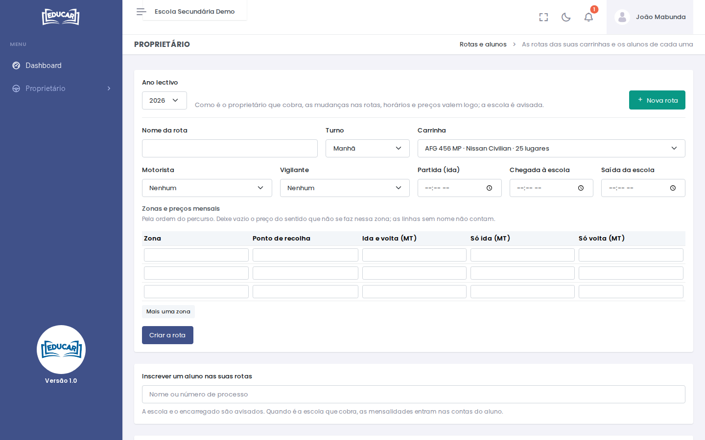

# Rotas e alunos

**Menu:** Proprietário › Rotas e alunos
**Quem vê:** Proprietário de transporte

As rotas que as carrinhas do proprietário fazem nesta escola, no ano lectivo escolhido, com os alunos de cada uma. Para cada rota há a **Lista para o motorista**, em PDF.

## Rotas, horários e preços

O proprietário pode criar rotas, corrigir o nome, o turno, as horas, a carrinha e o pessoal, e acrescentar ou mudar zonas e preços. O que acontece depende do [acordo do ano](../transporte/acordos.md):

- **o proprietário cobra directamente**: a mudança vale logo e a escola é avisada;
- **a escola cobra e repassa**: a mudança fica **À espera da escola**. O gestor do transporte ou o director aprovam-na (e passa a valer) ou recusam-na com o motivo. O proprietário é avisado da decisão.

Sem acordo no ano, as rotas não se podem mudar.

### Criar uma rota

1. Use **Nova rota**.
2. Dê o nome, o turno, a carrinha, o motorista e o vigilante, e as horas.
3. Em **Zonas e preços mensais**, escreva as zonas pela ordem do percurso, com o ponto de recolha e o preço por mês de cada sentido. Deixe vazio o sentido que não se faz; **Mais uma zona** acrescenta linhas.
4. Use **Criar a rota** (ou **Pedir a rota à escola**).

### Mudar uma rota ou uma zona

Na rota, **Corrigir rota** muda os dados da rota e **Zonas e preços** mostra as zonas para corrigir e para acrescentar uma nova. Os preços novos valem para as inscrições novas: as inscrições já feitas mantêm o preço com que foram feitas.

### Os pedidos

Em **Os seus pedidos e mudanças** ficam todas as mudanças, com o estado: **À espera da escola**, **Aprovado**, **Recusado** (com o motivo), **Anulado** ou **Aplicado**. Um pedido à espera pode ser anulado; enquanto espera, não se faz outra mudança na mesma rota ou zona.

## Inscrever alunos

Com acordo no ano, o proprietário também inscreve alunos nas suas rotas:

1. Em **Inscrever um aluno nas suas rotas**, procure o aluno pelo nome ou pelo número de processo e use **Inscrever**.
2. Escolha a rota, a zona, o sentido e os meses, como na [inscrição feita pela escola](../transporte/inscricoes.md#inscrever-um-aluno).

Nos alunos de cada rota, **Mudar** passa a inscrição para outra rota, zona ou sentido a partir do mês seguinte, **Terminar** acaba a inscrição e **Dar o lugar** activa um aluno em lista de espera. As mensalidades, a lista de espera e os avisos ao encarregado funcionam como quando é a escola a inscrever, e a escola é avisada.
