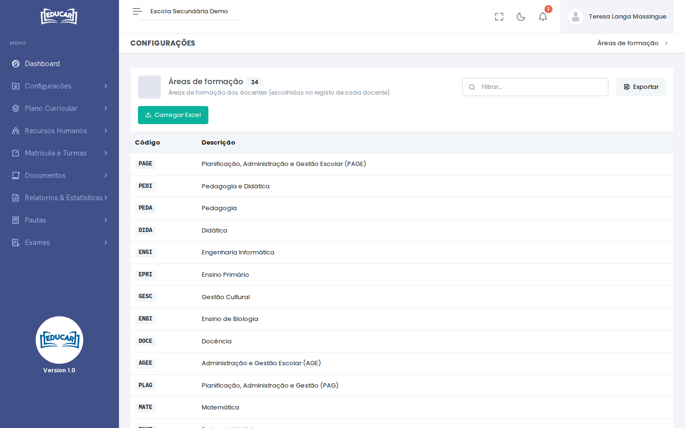

# Áreas de Formação

**Menu:** Recursos Humanos › Áreas de Formação
**Quem vê:** Director da escola, Director pedagógico

As áreas de formação que se podem escolher no registo de cada docente, como `Ensino de Matemática` ou `Pedagogia`.

## Acrescentar ou corrigir áreas

As áreas carregam-se a partir de um ficheiro Excel, com as colunas **Código** e **Descrição**.

1. Use **Exportar** para descarregar a lista actual, no formato do carregamento.
2. Acrescente as linhas das áreas novas ou corrija as descrições.
3. Use **Carregar Excel** e escolha o ficheiro.

!!! warning "A lista é comum"
    As áreas são as mesmas para todas as escolas que usam o EDUCAR. Um código que já existe fica com a descrição do ficheiro, por isso corrija só o que tiver a certeza.
