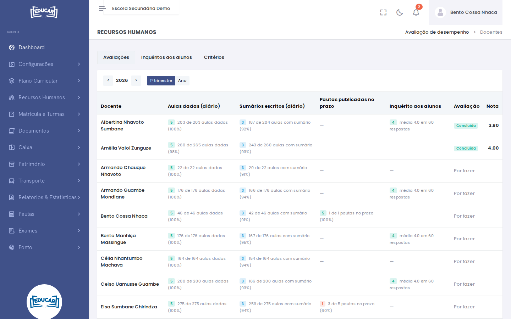
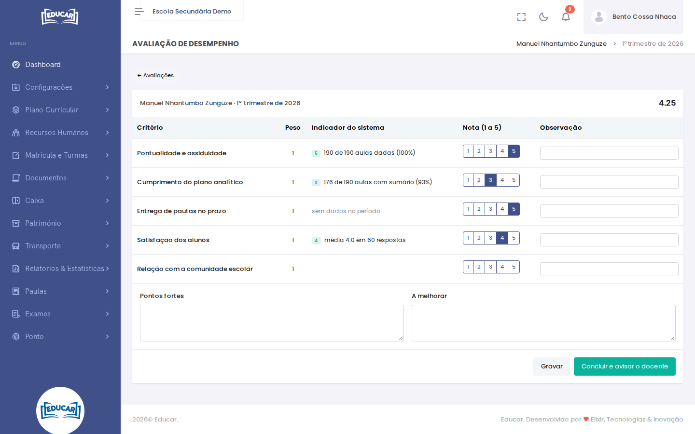
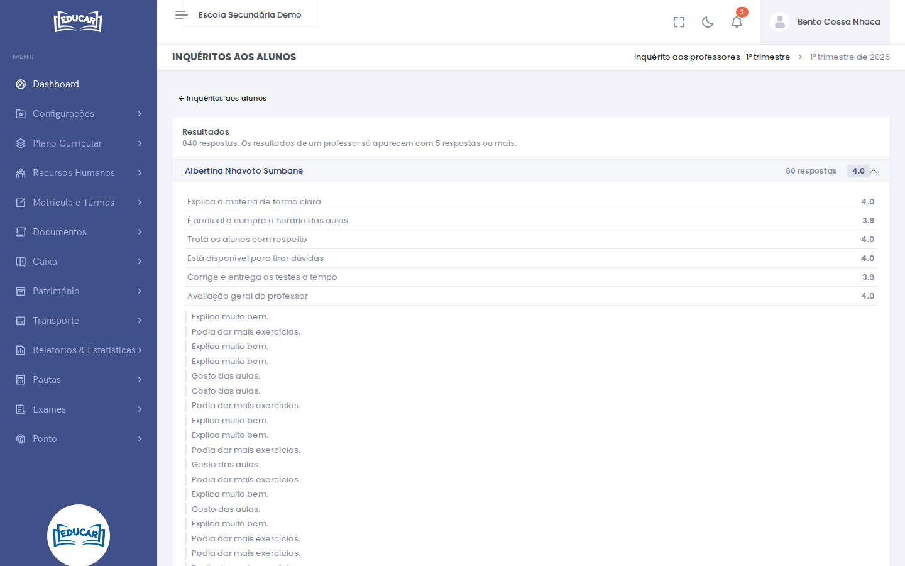

# Avaliação de desempenho

**Menu:** Recursos Humanos › Avaliação de desempenho
**Quem vê:** Director pedagógico, Director da escola, Gestor de recursos humanos (o RH só vê)

A direcção pedagógica avalia cada docente por período, em critérios da escola, com notas de 1 a 5. Alguns critérios têm um **indicador** calculado pelo sistema, que sugere a nota.

O ecrã tem três separadores: **Avaliações**, **Inquéritos aos alunos** e **Critérios**.

## Avaliações

Escolha o ano com as setas e o período: cada **trimestre** com datas no [Calendário Académico](../configuracoes/calendario-academico.md), ou o **Ano**. A lista mostra cada docente activo com:

- os indicadores do período (a nota sugerida e os números);
- o estado da avaliação (**Por fazer**, **Em curso**, **Concluída**) e se o docente já a viu;
- a nota final.

Os indicadores:

| Indicador | Como se calcula |
|---|---|
| Aulas dadas (diário) | Aulas dadas ÷ aulas previstas no período, sem as faltas justificadas, a partir das [aulas dos docentes](../ponto/aulas-dos-docentes.md) |
| Sumários escritos (diário) | Aulas registadas no diário com o sumário escrito ÷ aulas registadas. Mede o cumprimento do plano a partir do diário |
| Pautas publicadas no prazo | Avaliações com as notas publicadas até X dias depois da data marcada ÷ avaliações com esse prazo já passado (X em Critérios) |
| Inquérito aos alunos | A média das respostas dos alunos no inquérito do período (só com o mínimo de respostas) |

A nota sugerida vem da percentagem: 98 ou mais dá 5, 95 dá 4, 90 dá 3, 80 dá 2 e menos dá 1. É só uma sugestão: quem avalia decide.

## Avaliar um docente

Clique no docente.

1. Em cada critério, escolha a nota de **1 a 5**. Nos critérios com indicador, vem marcada a nota sugerida. Escreva uma observação, se quiser.
2. Escreva os **pontos fortes** e o que o docente tem **a melhorar**.
3. **Gravar** guarda a avaliação, que fica **Em curso**.
4. **Concluir e avisar o docente** fecha a avaliação e envia-lhe um aviso. Todos os critérios têm de ter nota.

A nota final é a **média ponderada** das notas, pelo peso de cada critério. Na avaliação concluída ficam guardados os indicadores desse dia. O docente vê a avaliação em [Ponto › As minhas avaliações](../ponto/as-minhas-avaliacoes.md) e regista que tomou conhecimento, com um comentário se quiser. **Reabrir** volta a pôr a avaliação em curso.

## Inquéritos aos alunos

O inquérito pergunta aos alunos o que pensam de cada professor da turma, de 1 a 5. É **anónimo**: o sistema guarda quem já respondeu (para não responder duas vezes), mas as respostas não dizem de quem são.

1. Em **Novo inquérito**, escreva o título e escolha o período.
2. Indique os dias em que **abre** e **fecha**.
3. Reveja as perguntas: vêm seis propostas, que pode mudar ou completar. Depois de haver respostas, as perguntas já não mudam.

Enquanto está aberto, os alunos respondem em [Estudante › Inquérito aos professores](../estudante/inquerito-aos-professores.md).

Clique num inquérito para ver os resultados de cada professor: a média de cada pergunta e os comentários.

Os resultados de um professor só aparecem com o **mínimo de respostas** da escola, para que não se saiba quem respondeu. A média do inquérito do período é o indicador do critério **Satisfação dos alunos**.

## Critérios

A escola começa com cinco critérios:

- Pontualidade e assiduidade (aulas dadas);
- Cumprimento do plano analítico (sumários);
- Entrega de pautas no prazo (pautas);
- Satisfação dos alunos (inquérito);
- Relação com a comunidade escolar (nota da direcção).

Pode mudar o nome, a descrição, o **peso** (1 a 10) e de onde vem a nota sugerida, desactivar um critério ou juntar outros.

Também aqui se definem:

- o **prazo das pautas**: os dias depois da avaliação para publicar as notas (7 por omissão);
- o **mínimo de respostas** do inquérito (5 por omissão).
