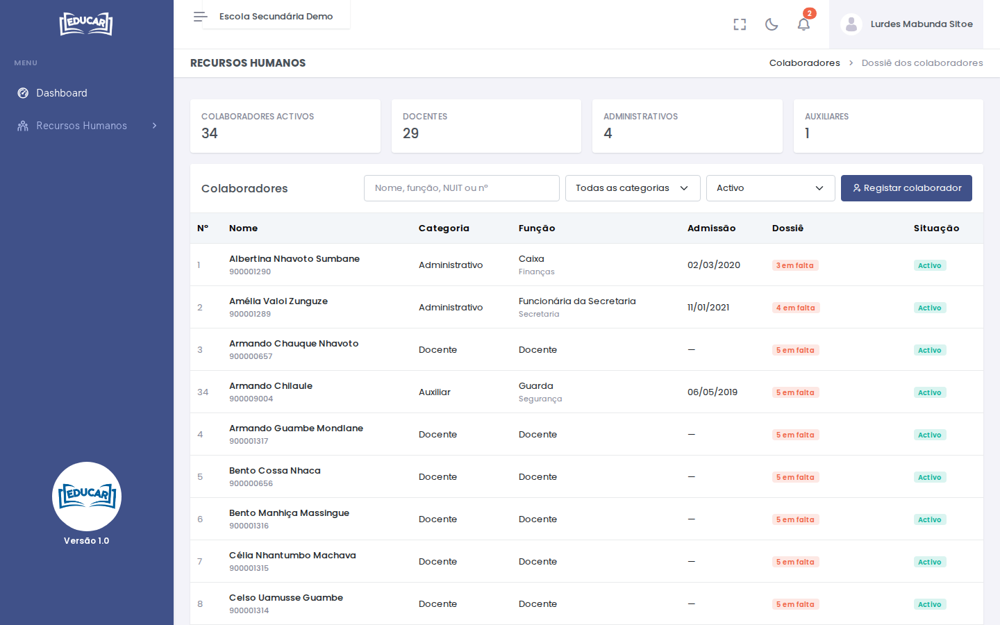
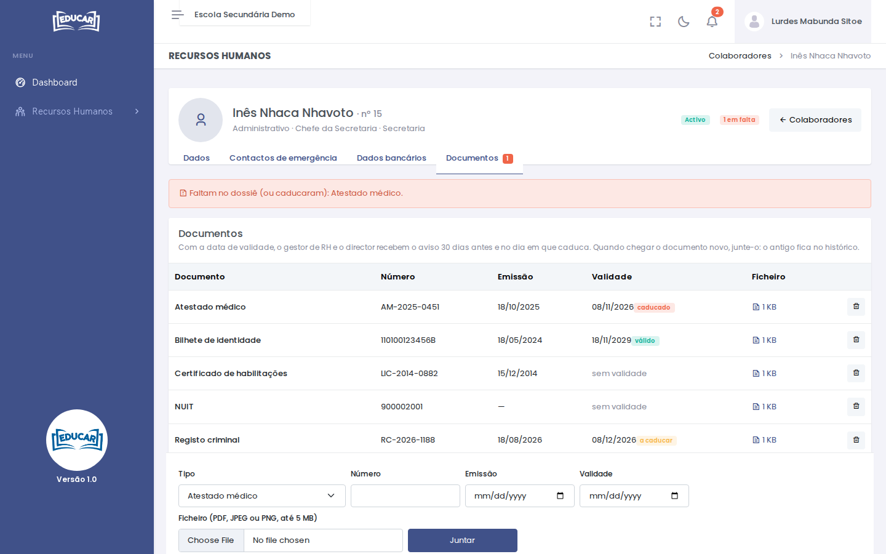

# Colaboradores

**Menu:** Recursos Humanos › Colaboradores
**Quem vê:** Gestor de recursos humanos, Director da escola

Todos os que trabalham na escola: administrativos, auxiliares e docentes, cada um com o seu dossiê (dados, contactos de emergência, dados bancários e documentos). Os docentes adicionados em [Docentes](docentes.md) passam a ser colaboradores sozinhos.

No topo, os totais dos colaboradores activos por categoria; clique num deles para filtrar. A lista mostra os activos: escolha outra situação, uma categoria ou escreva o nome, a função, o NUIT ou o número para procurar.

A coluna **Dossiê** mostra quantos documentos obrigatórios faltam (bilhete de identidade, NUIT, certificado de habilitações, registo criminal e atestado médico) e quantos caducam nos próximos 30 dias.

## Registar um colaborador

A pessoa tem de estar registada em [Pessoas](pessoas.md).

1. Use **Registar colaborador**.
2. Em **Pessoa**, escreva o nome, o NUIT ou o número do documento e escolha a pessoa na lista.
3. Escolha a **Categoria** (Administrativo, Auxiliar ou Docente) e escreva a **Função** (por exemplo, Secretária, Guarda). O **Sector** e a **Data de admissão** são opcionais.
4. Use **Registar**. O colaborador recebe o número seguinte da escola e abre-se a ficha, para completar o dossiê.

## A ficha do colaborador

- **Dados:** os dados pessoais (para os corrigir, use **Editar em Pessoas**) e os do colaborador: categoria, função, sector, admissão e observações. Em **Situação**, suspenda (com o motivo), dê como **Cessado** (com a data de saída e o motivo) ou volte a pôr como activo.
- **Contactos de emergência:** quem avisar em caso de acidente ou doença, com o telefone.
- **Dados bancários:** o banco e o número da conta e/ou o NIB (21 algarismos), ou a carteira móvel, para pagar o salário.
- **Documentos:** o dossiê. Escolha o tipo, o número, as datas de emissão e de validade e o ficheiro (PDF, JPEG ou PNG, até 5 MB), e use **Juntar**. Clique no ficheiro para o abrir.

## Documentos a caducar

Com a data de validade, o gestor de recursos humanos e o director recebem um [aviso](../../primeiros-passos/avisos.md) 30 dias antes e outro no dia em que o documento caduca. Quando chegar o documento novo, junte-o com a nova validade: os avisos param e o antigo fica no histórico.
