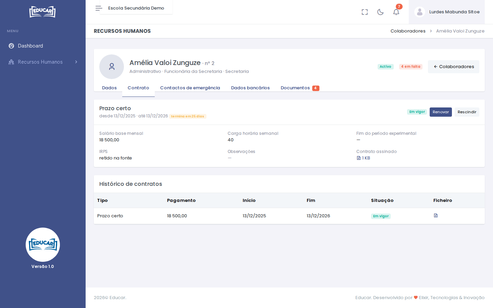
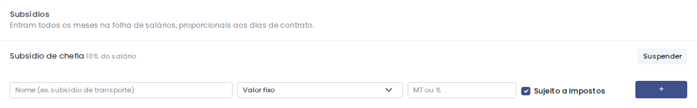

# Colaboradores

**Menu:** Recursos Humanos › Colaboradores
**Quem vê:** Gestor de recursos humanos, Director da escola

Todos os que trabalham na escola: administrativos, auxiliares e docentes, cada um com o seu dossiê (dados, contactos de emergência, dados bancários e documentos). Os docentes adicionados em [Docentes](docentes.md) passam a ser colaboradores sozinhos.

No topo, os totais dos colaboradores activos por categoria; clique num deles para filtrar. A lista mostra os activos: escolha outra situação, uma categoria ou escreva o nome, a função, o NUIT ou o número para procurar.

A coluna **Dossiê** mostra quantos documentos obrigatórios faltam (bilhete de identidade, NUIT, certificado de habilitações, registo criminal e atestado médico) e quantos caducam nos próximos 30 dias.

## Registar um colaborador

A pessoa tem de estar registada em [Pessoas](pessoas.md).

1. Use **Registar colaborador**.
2. Em **Pessoa**, escreva o nome, o NUIT ou o número do documento e escolha a pessoa na lista.
3. Escolha a **Categoria** (Administrativo, Auxiliar ou Docente) e escreva a **Função** (por exemplo, Secretária, Guarda). O **Sector** e a **Data de admissão** são opcionais.
4. Use **Registar**. O colaborador recebe o número seguinte da escola e abre-se a ficha, para completar o dossiê.

## A ficha do colaborador

- **Dados:** os dados pessoais (para os corrigir, use **Editar em Pessoas**) e os do colaborador: categoria, função, sector, admissão e observações. Em **Ponto**, o horário de trabalho e o número no relógio biométrico (veja [Ponto](ponto.md)). Em **Situação**, suspenda (com o motivo), dê como **Cessado** (com a data de saída e o motivo) ou volte a pôr como activo.
- **Contrato:** o contrato em vigor e o histórico (veja abaixo).
- **Contactos de emergência:** quem avisar em caso de acidente ou doença, com o telefone.
- **Dados bancários:** o banco e o número da conta e/ou o NIB (21 algarismos), ou a carteira móvel, para pagar o salário.
- **Documentos:** o dossiê. Escolha o tipo, o número, as datas de emissão e de validade e o ficheiro (PDF, JPEG ou PNG, até 5 MB), e use **Juntar**. Clique no ficheiro para o abrir.

## O contrato

Cada colaborador tem um contrato em vigor de cada vez. Sem contrato, a lista mostra **sem contrato**.

1. No separador **Contrato**, escolha o **Tipo de contrato**: tempo indeterminado (efectivo), prazo certo ou prestação de serviços.
2. Escolha o **Pagamento**:
    - **Salário mensal**, com o salário base. Com contrato a prazo ou sem prazo, tem horas extra (veja [Definições de RH](definicoes-de-rh.md)); a prestação de serviços não tem.
    - **Por aula**, só para docentes que não são efectivos: recebem por aula dada, pelo valor do perfil do nível de ensino e do grau (ou de um perfil escolhido aqui), sem horas extra.
3. Indique o início e, no prazo certo, o fim. O fim do período experimental e a carga horária semanal são opcionais.
4. **Reter o IRPS** vem marcado; desmarque nos prestadores de serviços que não têm retenção.
5. Junte o contrato assinado (PDF, JPEG ou PNG) e use **Registar o contrato**.

Um contrato já terminado, registado para o histórico, fica logo como terminado.

- **Renovar:** indique o novo contrato. Começa no dia a seguir ao fim do anterior (ou na data indicada) e o anterior fica **Renovado**. O contrato a prazo certo só se renova a prazo certo dentro dos [limites da escola](definicoes-de-rh.md#limites-do-prazo-certo); o contrato mostra as renovações já feitas.
- **Rescindir:** a data e o motivo. Para registar a saída do colaborador, mude também a **Situação** em **Dados**.

O gestor de recursos humanos e o director recebem um aviso 60, 30 e 15 dias antes do fim de um contrato a prazo. Se o prazo passar sem renovação, o contrato fica **Terminado** e chega outro aviso.

## Subsídios

Por baixo do contrato ficam os **subsídios** do colaborador, que entram todos os meses na [folha de salários](folha-de-salarios.md).

1. Escreva o **nome** (ex. subsídio de transporte).
2. Diga se é um **valor fixo** (em MT) ou uma **percentagem do salário** base.
3. Desmarque **Sujeito a impostos** se o subsídio não conta para o INSS e o IRPS.
4. Carregue em **+**.

Os subsídios são proporcionais aos dias de contrato no mês. **Suspender** tira-o das folhas seguintes sem o apagar; **Retomar** volta a pô-lo.

## Documentos a caducar

Com a data de validade, o gestor de recursos humanos e o director recebem um [aviso](../../primeiros-passos/avisos.md) 30 dias antes e outro no dia em que o documento caduca. Quando chegar o documento novo, junte-o com a nova validade: os avisos param e o antigo fica no histórico.
