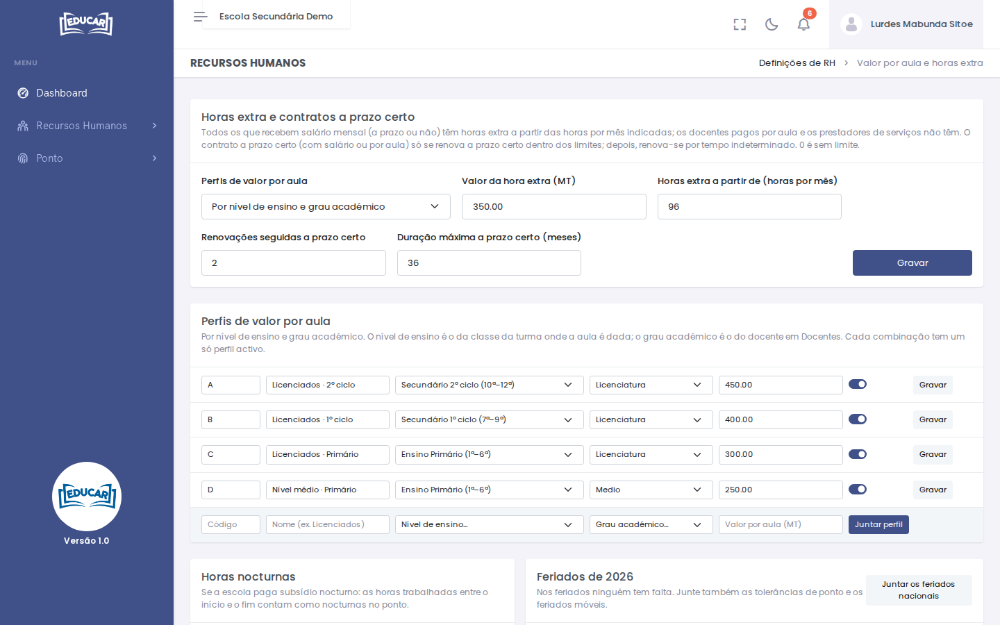

# Definições de RH

**Menu:** Recursos Humanos › Definições de RH
**Quem vê:** Gestor de recursos humanos, Director da escola

As horas extra, os limites dos contratos a prazo certo, o valor por aula dos docentes que não são efectivos, os atrasos e os feriados.

## Horas extra

Todos os que recebem **salário mensal**, com contrato a prazo ou sem prazo, recebem horas extra quando trabalham no mês mais horas do que as indicadas em **Horas extra a partir de (horas por mês)**. Cada hora a mais vale o **Valor da hora extra (MT)**. Os docentes pagos por aula e os prestadores de serviços não têm horas extra.

## Limites do prazo certo

O contrato a prazo certo, com salário ou pago por aula, só se renova a prazo certo até aos limites da escola:

- **Renovações seguidas a prazo certo:** quantas vezes se pode renovar.
- **Duração máxima a prazo certo (meses):** o tempo total, do início do primeiro contrato ao fim do novo.

Passado um dos limites, a renovação a prazo certo é recusada e o contrato renova-se por tempo indeterminado. O aviso de fim de contrato diz quando já não se pode renovar a prazo certo. Deixe 0 para não ter limite.

Use **Gravar**.

## Perfis de valor por aula

O docente que não é efectivo recebe por aula dada. O valor vem de um perfil (A, B, C…) que a escola define:

- **Por nível de ensino:** o nível é o da classe da turma onde a aula é dada: Ensino Primário (1ª–6ª), Secundário 1º ciclo (7ª–9ª) e 2º ciclo (10ª–12ª).
- **Por grau académico:** o grau do docente, registado em [Docentes](docentes.md).
- **Pelos dois:** cada combinação de nível e grau tem o seu valor.

Escolha a base em **Perfis de valor por aula** e use **Gravar**. Depois, em cada perfil, indique o código, o nome, o nível e/ou o grau e o valor por aula, e use **Juntar perfil**. Cada combinação só pode ter um perfil activo. Um perfil que deixa de se usar desliga-se (o interruptor) e **Gravar**.

No [contrato](colaboradores.md#o-contrato) de um docente pago por aula, o perfil é escolhido sozinho pelo nível e pelo grau; escolha um perfil só para um acordo diferente.

## Horas nocturnas

Se a escola paga subsídio nocturno, ligue **Tem subsídio nocturno** e indique a hora a que começam (**Das**) e a que acabam (**Às**) as horas nocturnas, por exemplo das 20:00 às 06:00. O [Ponto](ponto.md#o-mes) conta as horas trabalhadas nesse período; o valor do subsídio entra na folha de salários.

## Atrasos

Em **Horas de atraso que valem uma falta**, indique quantas horas de atraso no mês contam como uma falta (por exemplo, 4: com 4 horas e 30 minutos de atraso no mês, o colaborador tem uma falta a mais). Deixe 0 para não converter. Veja o resultado em [Ponto](ponto.md#o-mes).

## Feriados

Nos feriados ninguém tem falta. **Juntar os feriados nacionais** junta os feriados nacionais de data fixa do ano; confirme-os e junte os outros dias sem trabalho (tolerâncias de ponto, feriados da cidade) com o dia e o nome. O **x** tira um feriado da lista.
