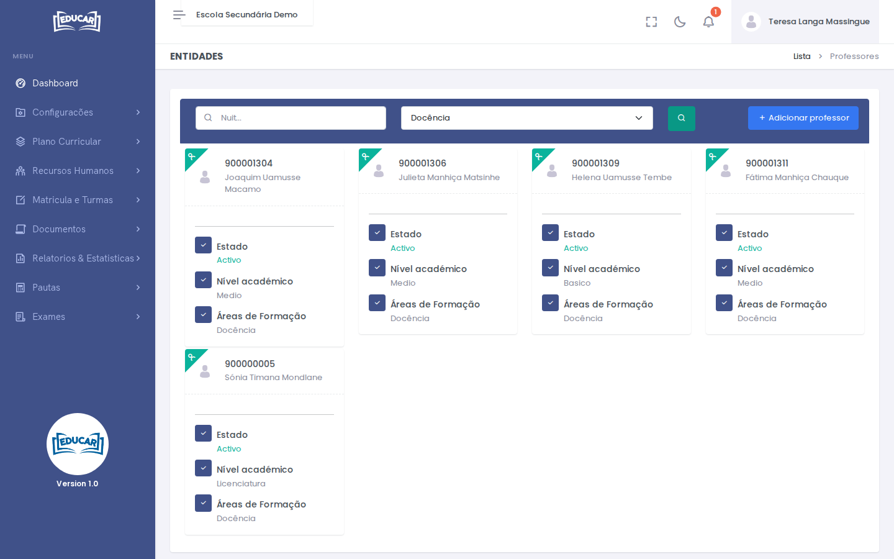
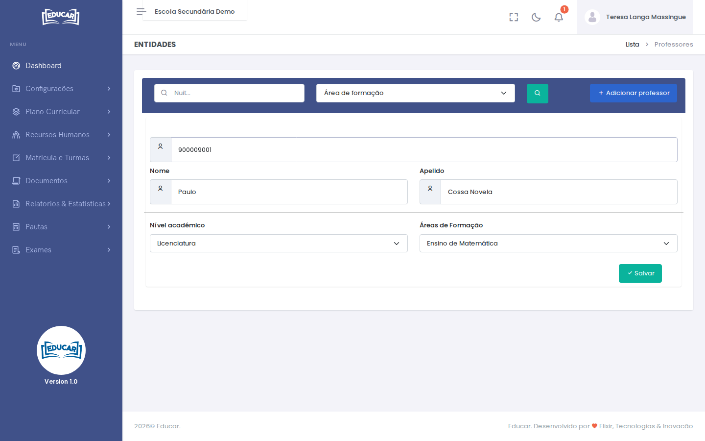
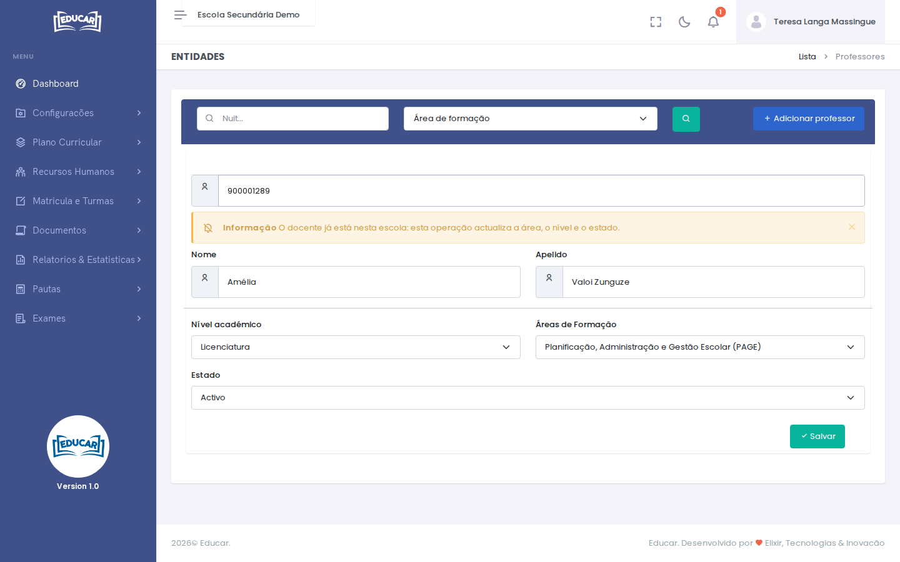

# Docentes

**Menu:** Recursos Humanos › Docentes
**Quem vê:** Director da escola, Director pedagógico

Os docentes da escola, com o nível académico, a área de formação e o estado. Daqui saem os professores que se escolhem nos horários e nos exames.

## Procurar docentes

O ecrã abre sem resultados. Escreva o **NUIT** do docente, com os 9 dígitos, ou escolha a **Área de formação**, e use a lupa.

Cada cartão mostra o NUIT e o nome, o **Estado**, o **Nível académico** e a **Área de formação**.

## Adicionar um docente

A pessoa tem de estar registada em [Pessoas](pessoas.md#registar-uma-pessoa), com o NUIT.

1. Use **Adicionar professor**.
2. Escreva o NUIT. Com os 9 dígitos, o formulário abre sozinho, com o nome da pessoa.
3. Escolha o **Nível académico** e a **Área de formação**.
4. Use **Salvar**.

Se a pessoa já for docente noutra escola, o nível e a área vêm preenchidos. Basta usar **Salvar** para a juntar a esta escola.

!!! note "Entrada no sistema"
    Ao adicionar um docente, o sistema cria-lhe o utilizador com o perfil de docente. O nome de utilizador é o **NUIT**. A senha inicial forma-se como a dos alunos, indicada em [Gerar códigos de alunos](../matricula-e-turmas/gerar-codigos-de-alunos.md). Ao entrar com ela, o sistema obriga-o a escolher uma senha nova: veja [Senha inicial](../../primeiros-passos/entrar.md#senha-inicial).

## Actualizar ou desactivar um docente

1. Use **Adicionar professor** e escreva o NUIT de quem já é docente da escola. O ecrã avisa que a operação actualiza os dados.
2. Mude o **Nível académico**, a **Área de formação** ou o **Estado**.
3. Use **Salvar**.

Um docente **Inactivo** deixa de poder entrar como docente nesta escola, logo ao gravar: as sessões abertas terminam. Se tiver outro perfil ou outra escola, continua a entrar com eles. Também deixa de aparecer nas escolhas de professores activos, como as equipas de correcção dos exames. Para lhe devolver o acesso, ponha o **Estado** em **Activo**.

O nome e os outros dados pessoais corrigem-se em [Pessoas](pessoas.md).

## Depois de adicionar

Para o docente dar aulas, indique-o no horário da turma: veja [Pesquisar Turma](../matricula-e-turmas/pesquisar-turma.md#horario-da-turma). O que o docente vê está em [Professor](../professor/as-minhas-turmas.md).
