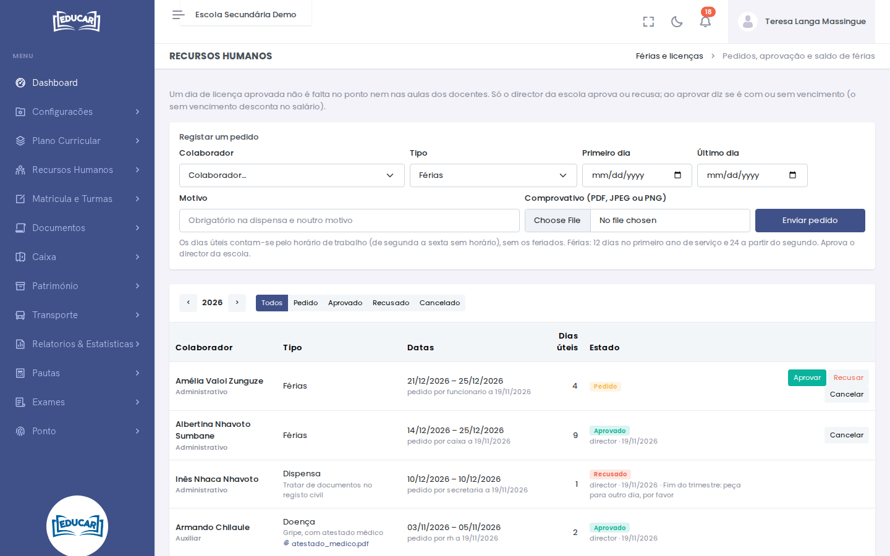

# Férias e licenças

**Menu:** Recursos Humanos › Férias e licenças
**Quem vê:** Gestor de recursos humanos, Director da escola

Aqui estão os pedidos de férias, licenças e dispensas de todos os colaboradores. O colaborador pede no seu ecrã ([Ponto › Os meus pedidos](../ponto/os-meus-pedidos.md)), ou o gestor de recursos humanos regista o pedido por ele. **Só o director da escola aprova ou recusa.**

## Tipos de pedido

| Tipo | Vencimento proposto |
|---|---|
| Férias | Com vencimento |
| Licença de maternidade | Com vencimento |
| Licença de paternidade | Com vencimento |
| Doença | Com vencimento |
| Luto | Com vencimento |
| Dispensa | Sem vencimento (indique o motivo) |
| Outro motivo | Sem vencimento (indique o motivo) |

Ao aprovar, o director confirma se o pedido é **com ou sem vencimento**. Os dias sem vencimento descontam no salário.

## Registar um pedido

1. Escolha o **colaborador**, o **tipo**, o **primeiro** e o **último dia**.
2. Escreva o **motivo**. É obrigatório na dispensa e noutro motivo.
3. Junte o **comprovativo** se o houver (atestado médico, certidão), em PDF, JPEG ou PNG, até 5 MB.
4. Carregue em **Enviar pedido**. O director e o gestor de recursos humanos recebem o aviso.

O sistema conta os **dias úteis** pelo horário de trabalho do colaborador:

- Num guarda em escala, contam só os dias de turno.
- Quem não tem horário trabalha de segunda a sexta.
- Os feriados da escola não contam.

Não se aceita um pedido que se sobreponha a outro, pedido ou aprovado, do mesmo colaborador.

## Férias

Cada colaborador tem, por ano civil:

- **12 dias úteis** no primeiro ano de serviço, o ano da admissão;
- **24 dias úteis** a partir do segundo ano.

O quadro **Férias** mostra, para cada colaborador, o direito, os dias aprovados, os por aprovar e os que faltam gozar. Um pedido que passe o saldo é recusado logo ao registar. As férias de cada ano pedem-se à parte: um pedido de 28/12 a 5/01 divide-se em dois.

## Aprovar ou recusar

Os pedidos por decidir aparecem primeiro. No filtro, **Pedido** mostra só esses.

- **Aprovar** — confirme ou tire o visto **Com vencimento** e, se quiser, escreva uma observação.
- **Recusar** — escreva o motivo. O colaborador recebe o aviso, com o motivo.

Um pedido por decidir, ou aprovado e ainda por começar, pode ser **cancelado**.

## O que muda no ponto e nas aulas

Um dia de licença aprovada **não é falta**:

- Em [Ponto](ponto.md), o dia aparece com o tipo da licença (por exemplo, **Férias**) em vez de falta.
- Em [Aulas dos docentes](../ponto/aulas-dos-docentes.md), as aulas do docente nesse dia ficam justificadas, com a nota **Licença aprovada**.

Estes dias não se tiram no ponto nem nas aulas. Para os mudar, cancele o pedido.
