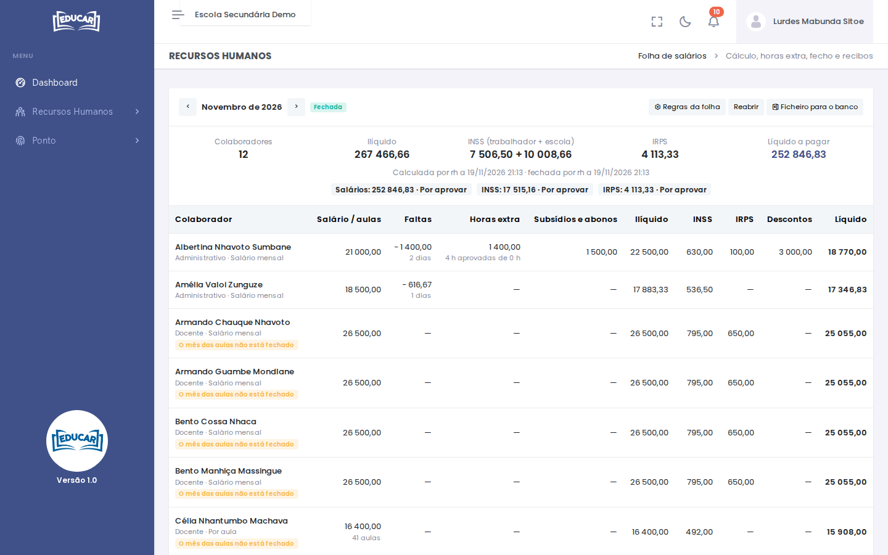
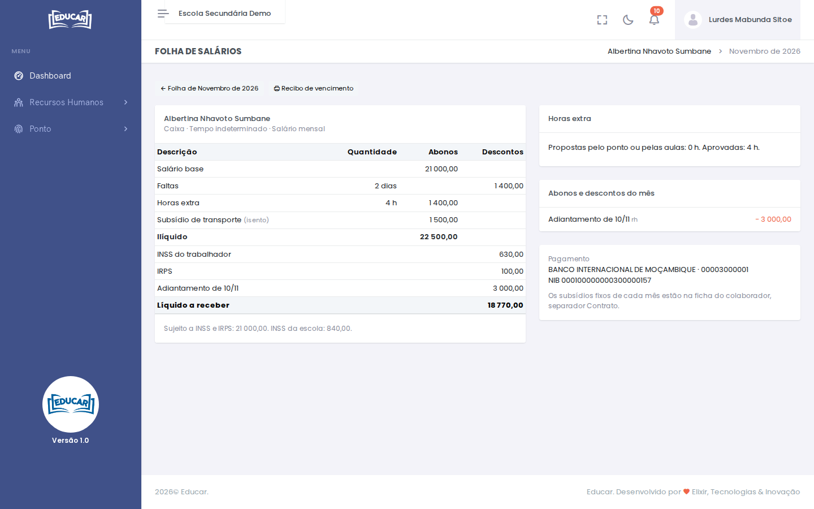
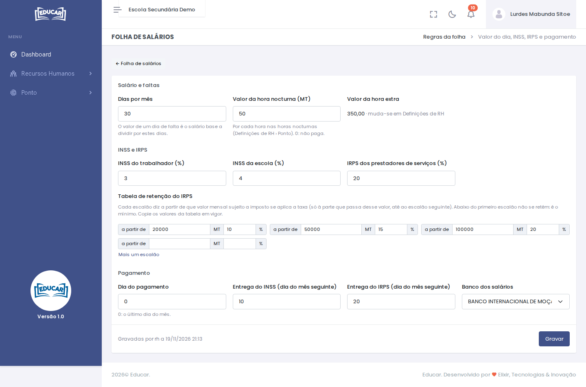

# Folha de salários

**Menu:** Recursos Humanos › Folha de salários
**Quem vê:** Gestor de recursos humanos, Director da escola

A folha calcula o salário de cada colaborador com contrato no mês. Usa o que já está no sistema:

- o contrato;
- o [ponto](ponto.md) ou, nos docentes, as [aulas](../ponto/aulas-dos-docentes.md);
- as [férias e licenças](ferias-e-licencas.md);
- os subsídios da ficha.

Fechada, passa às [contas a pagar](../tesouraria/contas-a-pagar.md) da Tesouraria, e cada colaborador recebe o seu recibo.

## Antes de calcular

1. Confira as **regras da folha** (botão **Regras da folha**, ver abaixo).
2. Confira o [ponto](ponto.md) do mês e as [aulas dos docentes](../ponto/aulas-dos-docentes.md). O ideal é que o director pedagógico já tenha **fechado o mês** das aulas.
3. Confira os **subsídios** e os **dados bancários** na ficha de cada colaborador ([Colaboradores](colaboradores.md)).

## Calcular

Escolha o mês com as setas e carregue em **Calcular a folha**. Enquanto a folha está em **Rascunho**, pode **Recalcular** quantas vezes quiser. As horas extra aprovadas e os abonos e descontos ficam.

Como se calcula o salário de cada colaborador:

| Parte | Como se calcula |
|---|---|
| Salário | O salário base do contrato, proporcional aos dias de contrato no mês (quem entrou ou saiu a meio do mês recebe só esses dias) |
| Aulas | Nos docentes pagos por aula: as aulas dadas (as suas e as de substituição) × o valor por aula |
| Faltas | Faltas do ponto (incluindo as faltas por atrasos) × o valor do dia, que é o salário base ÷ os dias por mês. Nos docentes com salário mensal: as aulas em falta × salário base ÷ aulas previstas no mês |
| Licença sem vencimento | Os dias úteis de licença aprovada sem vencimento × o valor do dia |
| Horas extra | Só as **aprovadas** × o valor da hora extra (não há horas extra nos docentes pagos por aula nem nos prestadores de serviços) |
| Horas nocturnas | As horas nas horas nocturnas do ponto × o valor da hora nocturna |
| Subsídios | Os da ficha: valor fixo ou percentagem do salário, proporcionais aos dias de contrato |
| INSS | A taxa do trabalhador sobre o que é sujeito a impostos (os prestadores de serviços não descontam) |
| IRPS | Pela tabela de retenção da escola; nos prestadores de serviços, a taxa fixa, se o contrato diz que se retém |
| Descontos | Os descontos do mês (adiantamentos, por exemplo) |

Por baixo do nome aparecem avisos a conferir, por exemplo:

- **Sem dados bancários**;
- **O mês das aulas não está fechado**;
- **Horas extra por aprovar**;
- **Sem tabela do IRPS**.

## O salário de um colaborador

Clique num colaborador para ver o salário em pormenor, como no recibo.

- **Horas extra** — mostra as horas propostas pelo ponto (as horas a mais) ou pelas aulas (acima do limite das Definições de RH). Só entram no salário depois de **aprovadas** pelo RH. Escreva as horas a pagar e carregue em **Aprovar horas**; aprove 0 para não pagar nenhuma. Na folha, **Aprovar as horas extra propostas** aprova de uma vez as de todos os que ainda não foram decididas.
- **Abonos e descontos do mês** — um desconto (adiantamento, empréstimo) ou um abono (prémio). Marque se o abono é **sujeito a INSS e IRPS**. O **x** tira-o.
- **Recibo de vencimento** — abre o recibo para imprimir ou guardar em PDF.

## Fechar

Quando tudo está conferido, carregue em **Fechar e enviar à Tesouraria**. O sistema:

- cria três contas a pagar em [Tesouraria › Contas a pagar](../tesouraria/contas-a-pagar.md):

    | Conta a pagar | Credor | Vence |
    |---|---|---|
    | Os salários líquidos | Colaboradores (salários) | No dia do pagamento |
    | O INSS do trabalhador e da escola | INSS (Segurança Social) | No dia de entrega do INSS do mês seguinte |
    | O IRPS retido | Autoridade Tributária (IRPS) | No dia de entrega do IRPS do mês seguinte |

- avisa cada colaborador de que tem o recibo em [Ponto › Os meus recibos](../ponto/os-meus-recibos.md).

As contas a pagar seguem as regras da Tesouraria (a aprovação do director financeiro acima do limite e o orçamento). A escola tem de ter o tipo de despesa **Salários** activo no Plano Financeiro.

**Reabrir** volta a pôr a folha em rascunho e anula as contas a pagar. Só é possível enquanto a Tesouraria não pagou nenhuma delas.

## Ficheiro para o banco

**Ficheiro para o banco** descarrega um Excel com a conta a debitar, a data do pagamento e, por colaborador, o nome, o NUIT, o banco, a conta, o NIB e o valor líquido.

## Regras da folha

| Regra | O que é |
|---|---|
| Dias por mês | O salário base a dividir por estes dias dá o valor de um dia de falta (habitualmente 30) |
| Valor da hora nocturna | Em MT, por cada hora nas horas nocturnas do ponto (0: não paga) |
| INSS do trabalhador e da escola | As percentagens (propostas: 3% e 4%) |
| IRPS dos prestadores de serviços | A percentagem retida aos prestadores de serviços |
| Tabela de retenção do IRPS | Os escalões (ver abaixo) |
| Dia do pagamento | O vencimento da conta a pagar dos salários (0: o último dia do mês) |
| Entrega do INSS e do IRPS | O dia do mês seguinte em que vencem |
| Banco dos salários | A conta da escola de onde saem os salários (aparece no ficheiro para o banco) |

O valor da hora extra muda-se em [Definições de RH](definicoes-de-rh.md).

**A tabela do IRPS.** Cada escalão tem o valor mensal sujeito a imposto a partir do qual se aplica e a taxa. A taxa aplica-se só à parte que passa desse valor, até ao escalão seguinte. Abaixo do primeiro escalão não se retém: é o valor mínimo. Copie os valores da tabela em vigor e confirme-os com o contabilista. Sem tabela, não se retém IRPS (a folha avisa).

Depois de mudar as regras, recalcule as folhas que estão em rascunho.
