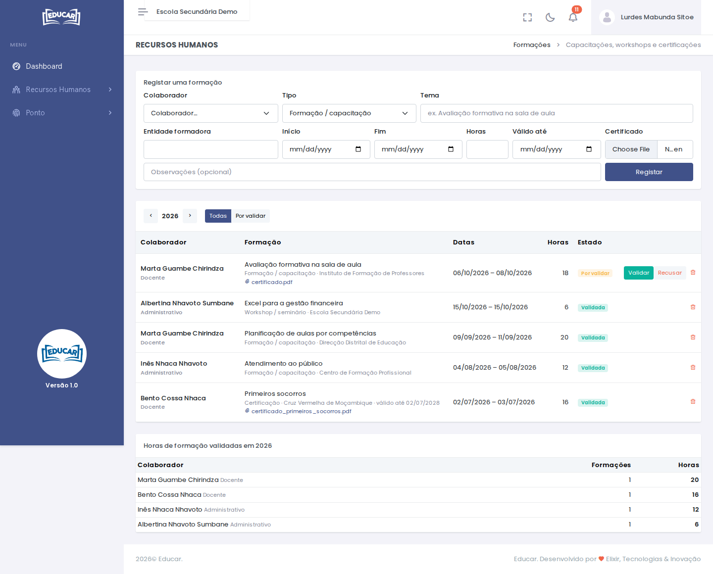

# Formações

**Menu:** Recursos Humanos › Formações
**Quem vê:** Gestor de recursos humanos, Director pedagógico, Director da escola

Aqui ficam as capacitações, workshops e certificações dos colaboradores ao longo do ano.

## Registar

1. Escolha o **colaborador** e o **tipo**: formação/capacitação, workshop/seminário, certificação ou outra.
2. Escreva o **tema** e a **entidade formadora**.
3. Indique as datas e as **horas**. Numa certificação com prazo, indique **Válido até**.
4. Junte o **certificado** (PDF, JPEG ou PNG, até 5 MB).
5. Carregue em **Registar**.

A formação registada aqui fica logo **validada**.

## Validar as que o colaborador registou

Cada colaborador pode registar as suas formações em [Ponto › As minhas formações](../ponto/as-minhas-formacoes.md). Essas ficam **Por validar**, e o RH e a direcção pedagógica recebem um aviso.

Use o filtro **Por validar** e confira o certificado. Depois:

- **Validar** aceita a formação;
- **Recusar** pede o motivo (por exemplo, falta o certificado).

## Horas de formação

Por baixo da lista ficam as **horas de formação validadas** no ano de cada colaborador, com o número de formações.
