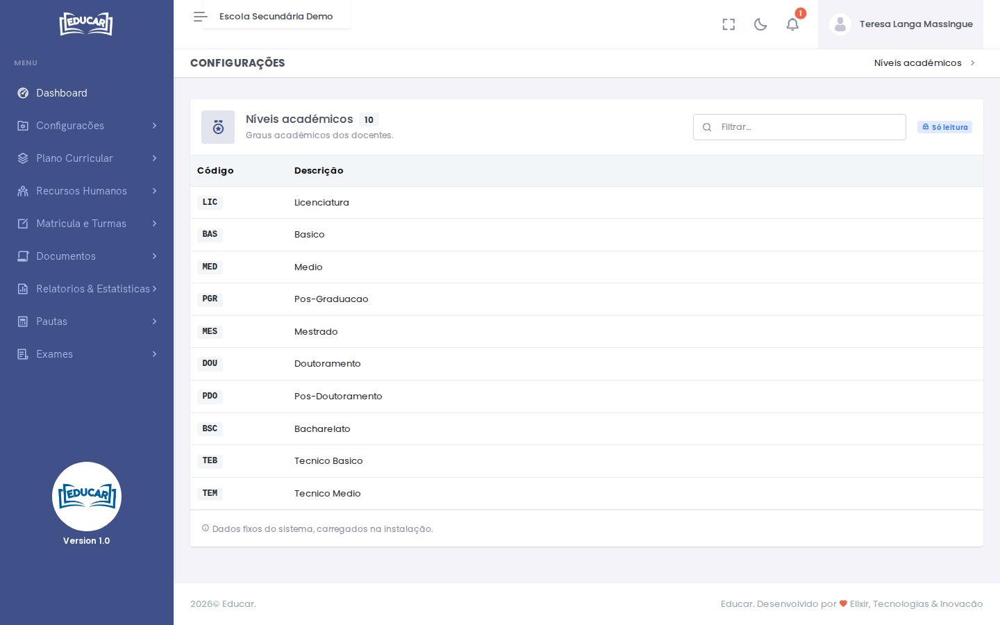

# Níveis académicos

**Menu:** Recursos Humanos › Níveis académicos
**Quem vê:** Director da escola, Director pedagógico

Os graus académicos que se podem escolher no registo de cada docente, como licenciatura, mestrado ou técnico médio.

Aqui só se consulta: a lista é fixa, carregada na instalação do sistema, e tem a etiqueta **Só leitura**. Para indicar o nível de um docente, use [Docentes](docentes.md).
