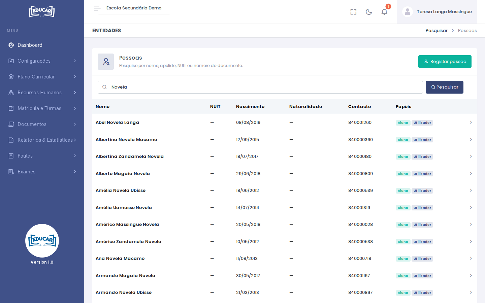
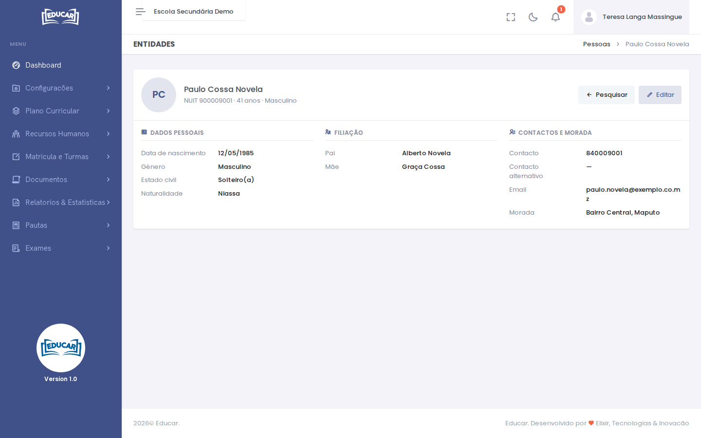
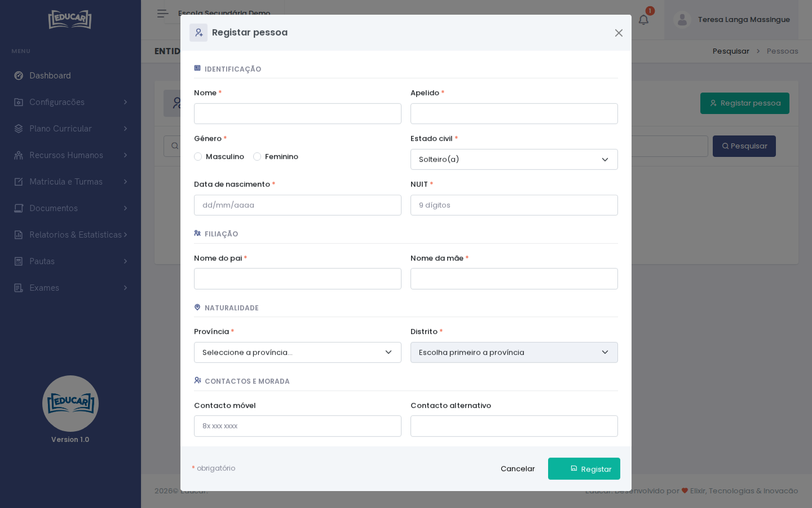

# Pessoas

**Menu:** Recursos Humanos › Pessoas
**Quem vê:** Director da escola, Director pedagógico

Os dados pessoais dos docentes, alunos e utilizadores da escola, e de quem a escola registou aqui. Cada escola só procura, abre e corrige as suas pessoas. Antes de adicionar um docente, a pessoa tem de estar registada, com o NUIT.

## Procurar uma pessoa

Escreva pelo menos 2 letras do nome ou do apelido, ou o NUIT ou o número do documento completos. A lista mostra até 50 pessoas: se não encontrar quem procura, escreva mais letras.

A coluna **Papéis** indica se a pessoa é **Docente**, **Aluno** ou **Utilizador**. Use a linha da pessoa para abrir a sua ficha.

**Editar** corrige os dados pessoais.

## Registar uma pessoa

Procure primeiro: a mesma pessoa não pode ser registada duas vezes com o mesmo NUIT.

1. Use **Registar pessoa**.
2. Preencha os campos. Os que têm `*` são obrigatórios:
    - **Identificação:** nome, apelido, género, estado civil, data de nascimento e NUIT, com 9 dígitos.
    - **Filiação:** nome do pai e nome da mãe.
    - **Naturalidade:** província e distrito.
    - **Contactos e morada:** a morada é obrigatória. O contacto móvel e o contacto alternativo têm 9 dígitos, e o email é opcional.
3. Use **Registar**. Se faltar alguma coisa, a mensagem aparece junto do campo.

Para tornar a pessoa docente da escola, continue em [Docentes](docentes.md#adicionar-um-docente).
