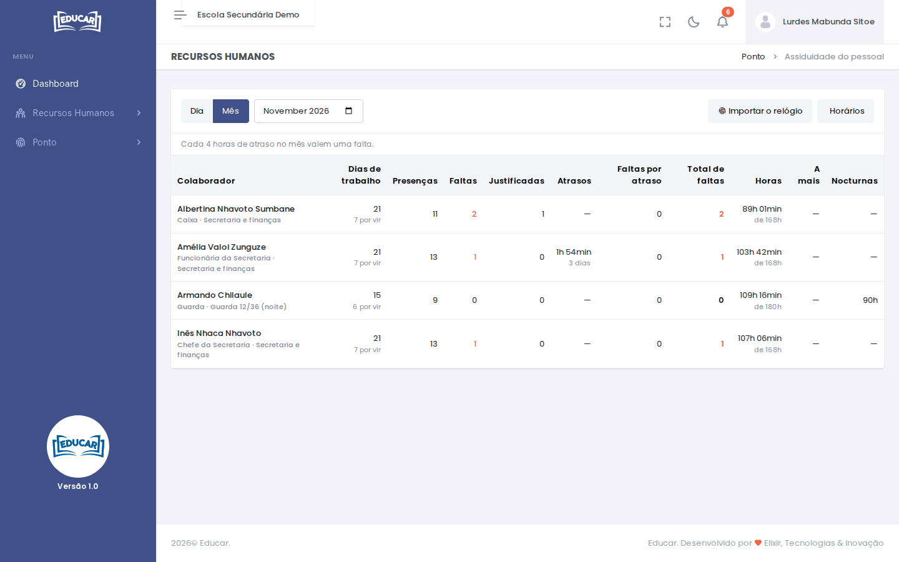

# Ponto

**Menu:** Recursos Humanos › Ponto
**Quem vê:** Gestor de recursos humanos, Director da escola

A assiduidade do pessoal com horário de trabalho: as entradas e as saídas de cada dia, os atrasos e as faltas, e o resumo do mês que vai para a folha de salários. As marcações vêm do relógio biométrico, do [registo digital](../ponto/o-meu-ponto.md) do próprio colaborador ou de uma correcção do RH.

## Antes de começar

1. Crie os **Horários** de trabalho (botão **Horários**), de um de dois tipos:
    - **Semanal:** os dias da semana, a hora de entrada e a de saída. Por exemplo, `Secretaria e finanças`, de segunda a sexta, das 07:30 às 15:30. Uma saída antes da entrada é no dia seguinte (um turno da noite das 22:00 às 06:00).
    - **Escala:** as horas de trabalho e as de descanso, como 12/36 ou 24/48 (a soma tem de dar dias inteiros), e a hora de entrada do turno. Por exemplo, `Guarda 12/36 (noite)`, 12 horas a partir das 18:00 e 36 de descanso.

    Indique também os minutos de tolerância.
2. Na ficha de cada colaborador, em **Dados › Ponto**, escolha o **Horário de trabalho** e, se a escola tem relógio biométrico, o **Número no relógio** (o número do colaborador no relógio). Numa escala, indique o **Início da escala**: o dia do primeiro turno; a partir daí os turnos repetem-se sozinhos. Um colaborador sem horário não controla o ponto.
3. Em [Definições de RH](definicoes-de-rh.md), indique quantas horas de atraso valem uma falta e junte os feriados.

## O dia

Para cada colaborador com horário, no dia escolhido: a **Entrada** (a primeira marcação), a **Saída** (a última), o **Atraso** e a **Situação**. Num turno que acaba no dia seguinte, a saída conta no dia em que o turno começou (aparece com **+1**).

- **Presente**, ou **Atraso** quando chegou depois da hora de entrada mais a tolerância. O atraso conta desde a hora de entrada.
- **Falta**: um dia de trabalho sem marcações (depois da hora de saída do horário).
- **Falta justificada**, **Folga** (dia sem trabalho no horário), **Feriado**, **Por registar** (o dia ainda não acabou).

Para corrigir:

- **Juntar uma marcação** (o relógio): quando o colaborador se esqueceu de marcar. Indique a hora e o motivo. Só estas marcações se podem apagar.
- **Justificar**: a falta ou o atraso, com o motivo (por exemplo, doença com atestado). A falta ou o atraso justificado não conta para os descontos.

## O mês

Em **Mês**: os dias de trabalho, as presenças, as faltas (sem justificação), as justificadas, os atrasos (o tempo e os dias), as **Faltas por atraso**, o **Total de faltas** e as horas: trabalhadas (das previstas), **a mais** e **nocturnas**. Os minutos de atraso somam-se no mês e cada X horas valem uma falta (X nas Definições de RH). O total de faltas é o que desconta no salário.

As **horas a mais** contam por dia, quando o colaborador trabalha 30 minutos ou mais além do turno, e todas as horas num dia sem turno (folga ou feriado). São a base das horas extra de quem tem salário mensal; os docentes pagos por aula e os prestadores de serviços não têm horas extra. As **horas nocturnas** só contam se a escola tem subsídio nocturno (veja [Definições de RH](definicoes-de-rh.md#horas-nocturnas)).

Clique num colaborador para ver o mês dele, dia a dia, com as marcações e as correcções.

## Importar o relógio biométrico

Com relógio ZKTeco (ou outro que exporte as marcações):

1. Tire as marcações do relógio: o ficheiro `attlog.dat` na pen USB, ou a exportação do software do relógio em CSV ou Excel.
2. Use **Importar o relógio**, escolha o ficheiro e use **Importar**.

Cada marcação é do colaborador com o mesmo **Número no relógio**. Os números sem colaborador aparecem na mensagem: indique-os na ficha e importe outra vez. Pode importar o mesmo ficheiro (ou um que se sobrepõe) as vezes que quiser: as marcações já importadas não se repetem.
