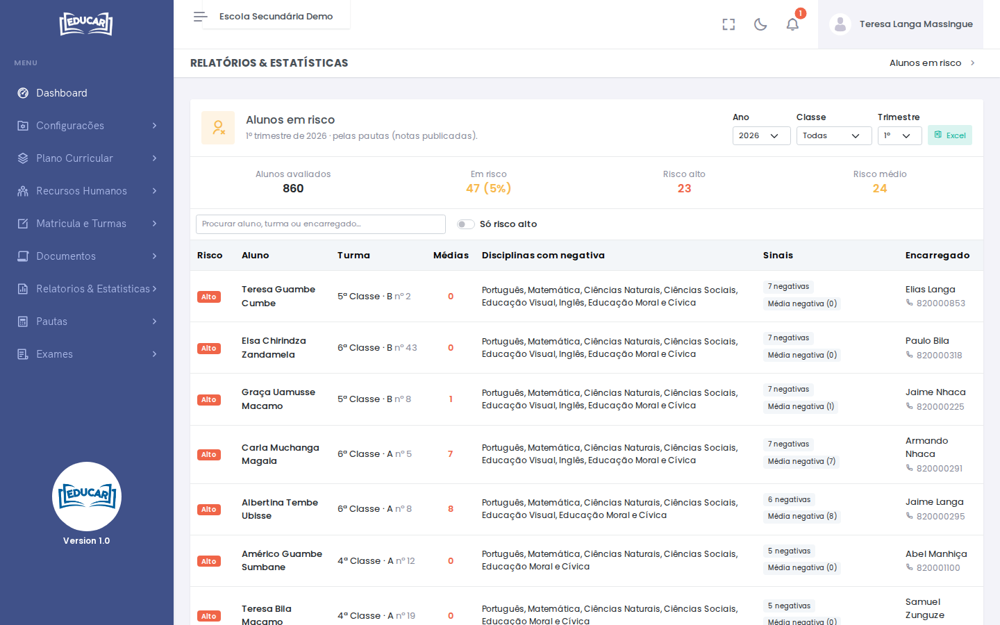

# Alunos em Risco

**Menu:** Relatórios e Estatísticas › Alunos em Risco
**Quem vê:** Director da escola, Director pedagógico

Os alunos que precisam de atenção num trimestre, com o contacto do encarregado. Os dados vêm das pautas, só com as notas publicadas.

Escolha o **Ano**, a **Classe** e o **Trimestre**. O relatório abre no trimestre em curso.

## Os sinais de risco

| Sinal | Quando aparece |
|---|---|
| **Negativas** | 3 ou mais disciplinas com negativa no trimestre |
| **Média negativa** | A média do trimestre é inferior a 10 |
| **Negativa repetida** | A mesma disciplina teve negativa também no trimestre anterior; aparece a vermelho |
| **A média desceu** | A média desceu 2 valores ou mais em relação ao trimestre anterior |

Um sinal é risco **Médio**. Dois ou mais sinais são risco **Alto**. Os dois últimos sinais só existem a partir do 2º trimestre. As disciplinas qualitativas não entram.

## Usar a lista

Os casos mais graves vêm primeiro. Cada linha mostra a turma e o número do aluno, a média de cada trimestre até ao escolhido, as disciplinas com negativa, os sinais e o encarregado com o contacto.

- A caixa de procura encontra um aluno, uma turma ou um encarregado.
- **Só risco alto** esconde os outros casos.
- **Excel** descarrega a lista com os mesmos filtros.
