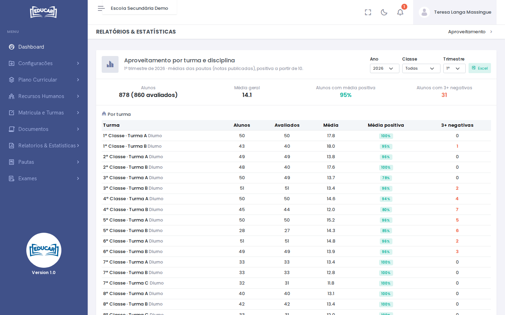
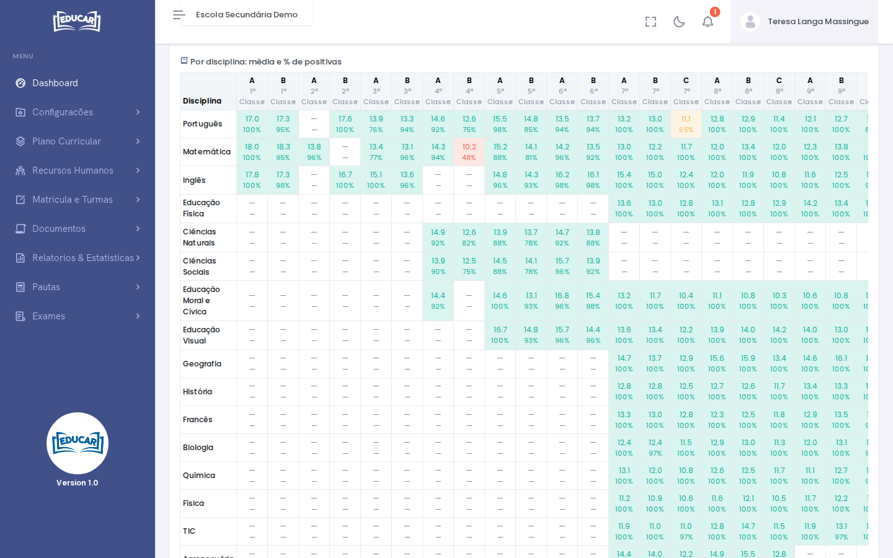

# Aproveitamento

**Menu:** Relatórios e Estatísticas › Aproveitamento
**Quem vê:** Director da escola, Director pedagógico

Como correu um trimestre, por turma e por disciplina. As médias vêm das pautas, só com as notas publicadas. A nota é positiva a partir de 10.

Escolha o **Ano**, a **Classe** e o **Trimestre**. O relatório abre no trimestre em curso: se ainda não houver notas publicadas, escolha um trimestre anterior.

## Por turma

No topo estão o número de alunos e de **avaliados**, a **Média geral**, a percentagem de **Alunos com média positiva** e os **Alunos com 3+ negativas**. A tabela mostra o mesmo para cada turma. Quando há menos avaliados do que alunos, faltam notas de alguns alunos: veja [Estado das Pautas](estado-das-pautas.md).

## Por disciplina

Cada célula mostra a média da disciplina na turma e, por baixo, a percentagem de positivas. A cor depende dessa percentagem:

| Cor | Positivas |
|---|---|
| Verde | 75% ou mais |
| Amarelo | 50% a 75% |
| Vermelho | menos de 50% |

Uma célula com `—` não tem notas publicadas. As disciplinas qualitativas não entram.

**Excel** descarrega o relatório com os mesmos filtros.
