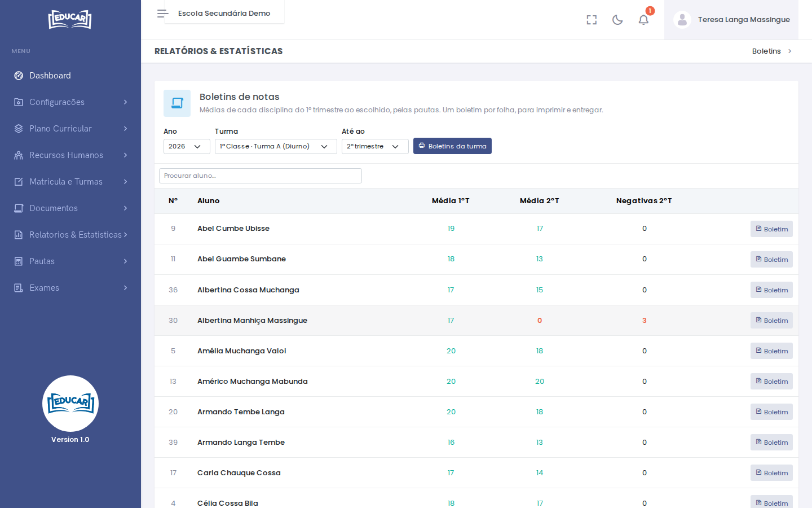
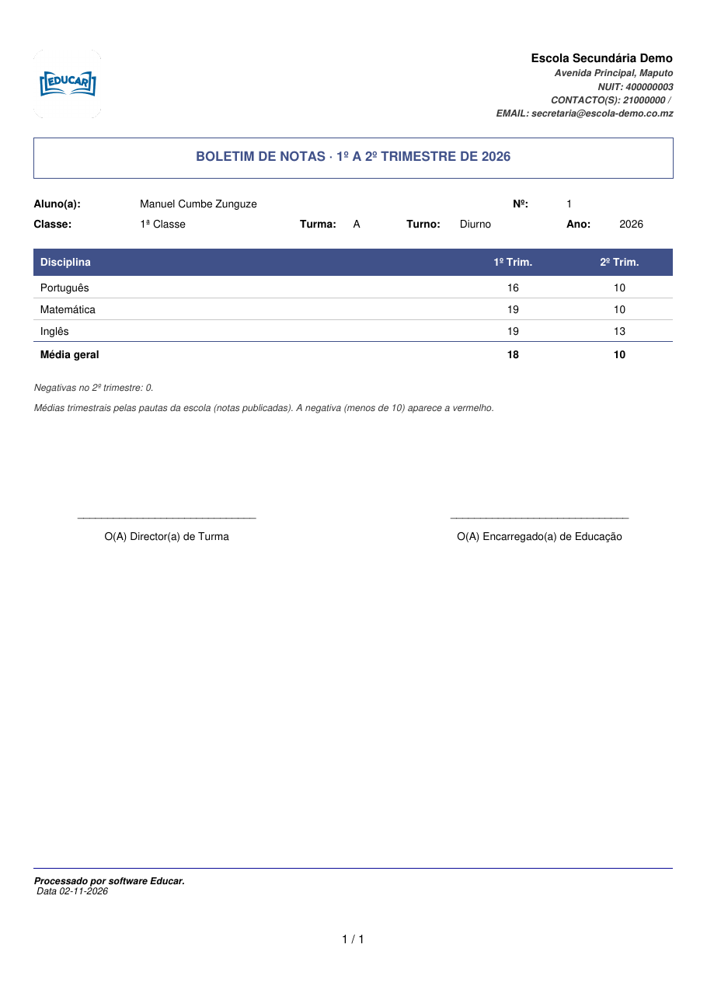

# Boletins

**Menu:** Relatórios e Estatísticas › Boletins
**Quem vê:** Chefe da secretaria, Director da escola, Director pedagógico, Funcionário da secretaria

Os boletins de notas de uma turma, um por folha, para imprimir e entregar. Mostram as médias de cada disciplina do 1º trimestre até ao trimestre escolhido, pelas pautas, só com as notas publicadas.

## Imprimir boletins

1. Escolha o **Ano**, a **Turma** e **Até ao** trimestre que quer incluir.
2. Confira a lista: cada aluno aparece com a média de cada trimestre e as negativas do último. Para encontrar um aluno, use a caixa de procura.
3. Use **Boletins da turma** para abrir todos os boletins, ou **Boletim** para abrir só o de um aluno. O PDF abre noutro separador, pronto a imprimir.

## O boletim

O boletim traz as notas de cada disciplina em cada trimestre, a **Média geral** e o número de negativas do último trimestre. A negativa, abaixo de 10, aparece a vermelho. No fim há espaço para as assinaturas do director de turma e do encarregado de educação.

!!! note "Média geral"
    A média geral conta só as disciplinas que entram na média, segundo o plano curricular da escola. Uma disciplina fora da média aparece no boletim, mas não entra na conta: é por isso que, na imagem, a média do 2º trimestre não inclui o Inglês.

!!! tip "Notas em falta"
    Antes de imprimir, confirme em [Estado das Pautas](estado-das-pautas.md) que as pautas do trimestre estão completas. Uma nota por publicar não aparece no boletim.
