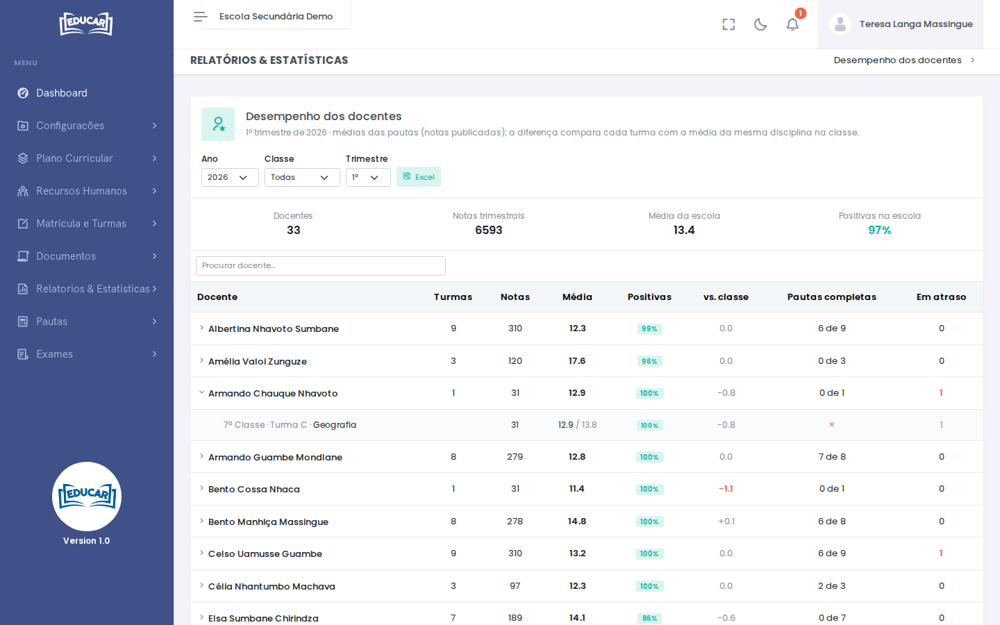

# Desempenho dos Docentes

**Menu:** Relatórios e Estatísticas › Desempenho dos Docentes
**Quem vê:** Director da escola, Director pedagógico

Os resultados das turmas de cada docente num trimestre e se as pautas estão em dia. As médias vêm das pautas, só com as notas publicadas.

Escolha o **Ano**, a **Classe** e o **Trimestre**. No topo estão o número de **Docentes** e de **Notas trimestrais**, a **Média da escola** e as **Positivas na escola**.

## O que cada coluna diz

| Coluna | O que mostra |
|---|---|
| **Turmas** | As turmas e disciplinas do docente |
| **Notas** | As notas trimestrais dos alunos |
| **Média** | A média dessas notas |
| **Positivas** | A percentagem de notas positivas |
| **vs. classe** | A diferença para a média da mesma disciplina na classe, em todas as turmas |
| **Pautas completas** | Quantas das suas pautas estão completas |
| **Em atraso** | As avaliações que já passaram da data marcada e ainda não foram publicadas |

**Procurar docente** encontra um nome na lista. Clique num docente para ver cada turma e disciplina. Na linha da turma, a média aparece ao lado da média da disciplina na classe. As disciplinas qualitativas não entram.

!!! note "Como ler a comparação"
    Quando um docente dá todas as turmas de uma disciplina na classe, a diferença fica perto de 0.0, porque a comparação é com as suas próprias turmas.

**Excel** descarrega o relatório com os mesmos filtros.
