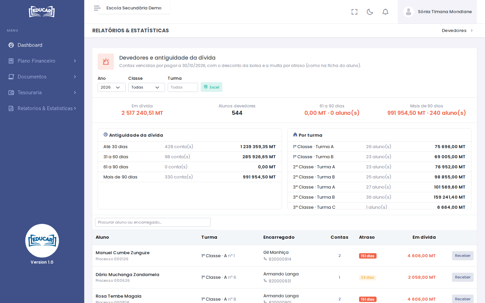

# Devedores

**Menu:** Relatórios e Estatísticas › Devedores
**Quem vê:** Chefe da secretaria, Director da escola, Director financeiro, Funcionário das finanças

Os alunos com contas vencidas por pagar: propinas, matrícula, cobranças, documentos… O valor em dívida é o da ficha do aluno, ou seja, com o desconto da bolsa e a multa por atraso.

## Ler o relatório

Escolha o **Ano** e, se quiser, a **Classe** e a **Turma**.

- No topo: o total **Em dívida**, o número de **Alunos devedores** e as dívidas mais antigas (61 a 90 dias e mais de 90 dias).
- **Antiguidade da dívida**: as contas e o valor por tempo de atraso (até 30 dias, 31 a 60, 61 a 90, mais de 90).
- **Por turma**: quantos alunos devem e quanto, em cada turma.
- A lista de alunos: o encarregado e o contacto, quantas contas, o atraso da conta mais antiga e o valor em dívida.

**Receber** abre as contas por pagar do aluno, para registar o pagamento (veja [Registar um pagamento](../matricula-e-turmas/pesquisar-turma.md#registar-um-pagamento)).

**Excel** descarrega a lista com os mesmos filtros, por exemplo para ligar aos encarregados.
