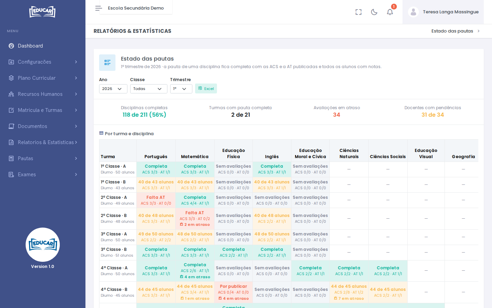
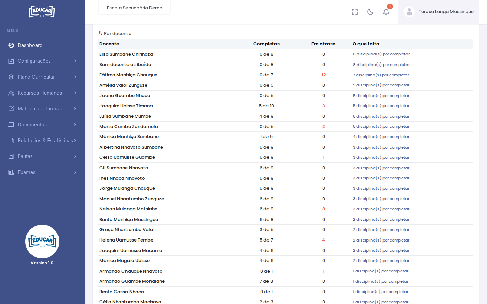

# Estado das Pautas

**Menu:** Relatórios e Estatísticas › Estado das Pautas
**Quem vê:** Chefe da secretaria, Director da escola, Director pedagógico

O que falta para fechar as pautas de um trimestre, por turma e por docente. A pauta de uma disciplina fica completa com as ACS e a AT publicadas e todos os alunos com notas.

Escolha o **Ano**, a **Classe** e o **Trimestre**. No topo estão as **Disciplinas completas**, as **Turmas com pauta completa**, as **Avaliações em atraso** e os **Docentes com pendências**.

## Por turma e disciplina

| O que a célula diz | O que quer dizer |
|---|---|
| **Completa** | As avaliações estão publicadas e todos os alunos têm notas |
| **40 de 43 alunos** | Faltam notas de alguns alunos |
| **Falta ACS**, **Falta AT** | Falta publicar esse tipo de avaliação |
| **Por publicar** | Há avaliações marcadas que ainda não foram publicadas |
| **Sem avaliações** | O professor ainda não marcou avaliações |
| `—` | A turma não tem esta disciplina |

Por baixo, `ACS 3/3 · AT 1/1` conta as avaliações publicadas e as marcadas. **Em atraso** são as avaliações que já passaram da data marcada e ainda não foram publicadas. Passe o rato por uma célula para ver o docente.

## Por docente

Para cada docente: as disciplinas **Completas**, as avaliações **Em atraso** e **O que falta**. Quem tem mais disciplinas por completar vem primeiro. **Sem docente atribuído** junta as disciplinas sem professor: indique-o no horário da turma, em [Pesquisar Turma](../matricula-e-turmas/pesquisar-turma.md#horario-da-turma).

**Excel** descarrega o relatório com os mesmos filtros.

Para encerrar o trimestre de uma turma, use [Pautas › Trimestral](../pautas/trimestral.md).
