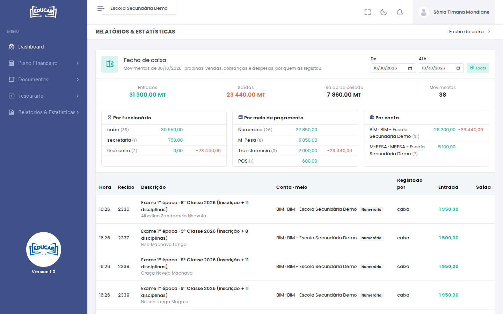

# Fecho de Caixa

**Menu:** Relatórios e Estatísticas › Fecho de Caixa
**Quem vê:** Director da escola, Director financeiro, Funcionário das finanças

O dinheiro que entrou e saiu num dia ou num período: propinas e outras contas dos alunos, vendas ao balcão, cobranças e despesas. Serve para conferir a caixa no fim do dia e saber quem recebeu o quê.

## Ler o fecho

Por omissão, o fecho mostra o dia de hoje. Para ver outro dia ou um período, mude **De** e **Até**.

- No topo: as **Entradas**, as **Saídas** e o **Saldo do período**.
- **Por funcionário**: quanto registou cada utilizador. Serve para conferir o dinheiro que cada um tem de entregar.
- **Por meio de pagamento**: numerário, M-Pesa, POS, transferência… O numerário é o que tem de estar na caixa.
- **Por conta**: em que conta entrou ou de que conta saiu o dinheiro.
- A lista: a hora, o recibo, a descrição e o aluno, a conta e o meio, quem registou e o valor.

As vendas anuladas no período aparecem à parte, em **Vendas anuladas no período (não contam)**. As transferências entre contas da escola não entram no fecho, porque o dinheiro não sai da escola.

**Excel** descarrega o fecho com os mesmos filtros.
