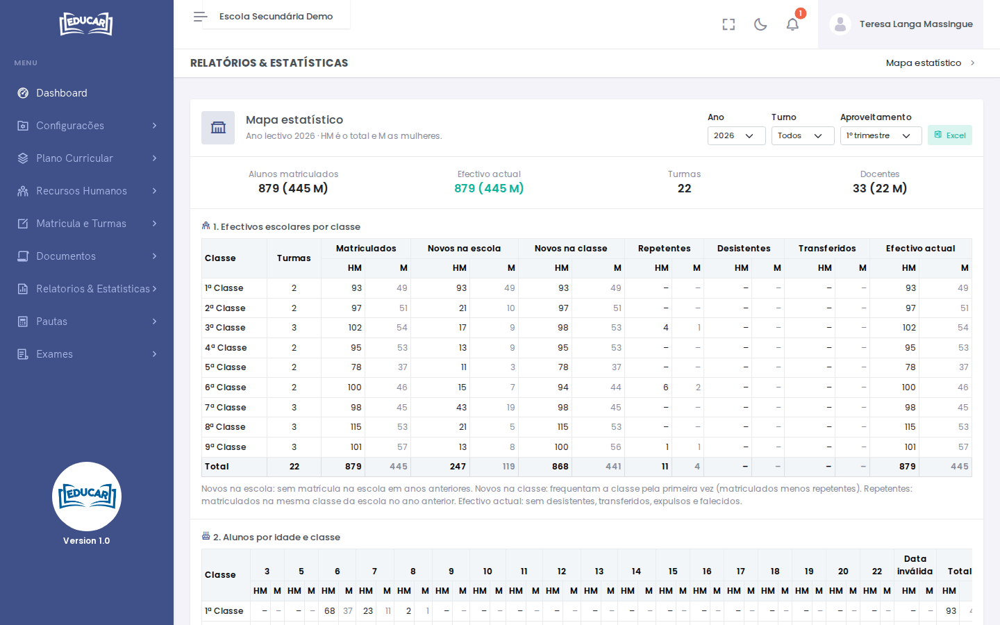
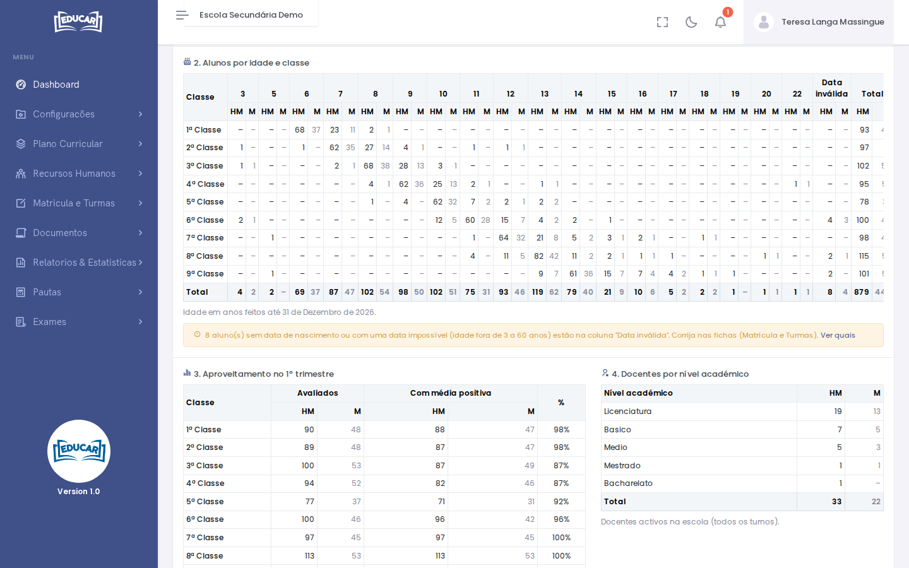

# Mapa Estatístico

**Menu:** Relatórios e Estatísticas › Mapa Estatístico
**Quem vê:** Chefe da secretaria, Director da escola, Director pedagógico

Os números da escola num ano lectivo: alunos, idades, aproveitamento e docentes. Nas tabelas, **HM** é o total e **M** são as mulheres.

Escolha o **Ano**, o **Turno** e o trimestre em **Aproveitamento**. No topo estão os **Alunos matriculados**, o **Efectivo actual**, as **Turmas** e os **Docentes**.

## 1. Efectivos escolares por classe

| Coluna | O que conta |
|---|---|
| **Matriculados** | Os alunos matriculados no ano |
| **Novos na escola** | Sem matrícula na escola em anos anteriores |
| **Novos na classe** | Frequentam a classe pela primeira vez (matriculados menos repetentes) |
| **Repetentes** | Matriculados na mesma classe da escola no ano anterior |
| **Desistentes**, **Transferidos** | Os alunos que saíram por esse motivo |
| **Efectivo actual** | Sem desistentes, transferidos, expulsos e falecidos |

## 2. Alunos por idade e classe

A idade é a de anos feitos até 31 de Dezembro do ano escolhido.

A coluna **Data inválida** junta os alunos sem data de nascimento ou com uma data impossível. **Ver quais** mostra esses alunos, para corrigir a data na [ficha do aluno](../matricula-e-turmas/pesquisar-turma.md).

## 3. Aproveitamento no trimestre

Pelas pautas: os alunos com média no trimestre escolhido e, desses, os que têm 10 ou mais.

## 4. Docentes por nível académico

Os docentes activos na escola, em todos os turnos. O nível académico de cada um indica-se em [Docentes](../recursos-humanos/docentes.md).

**Excel** descarrega o mapa com os mesmos filtros.
