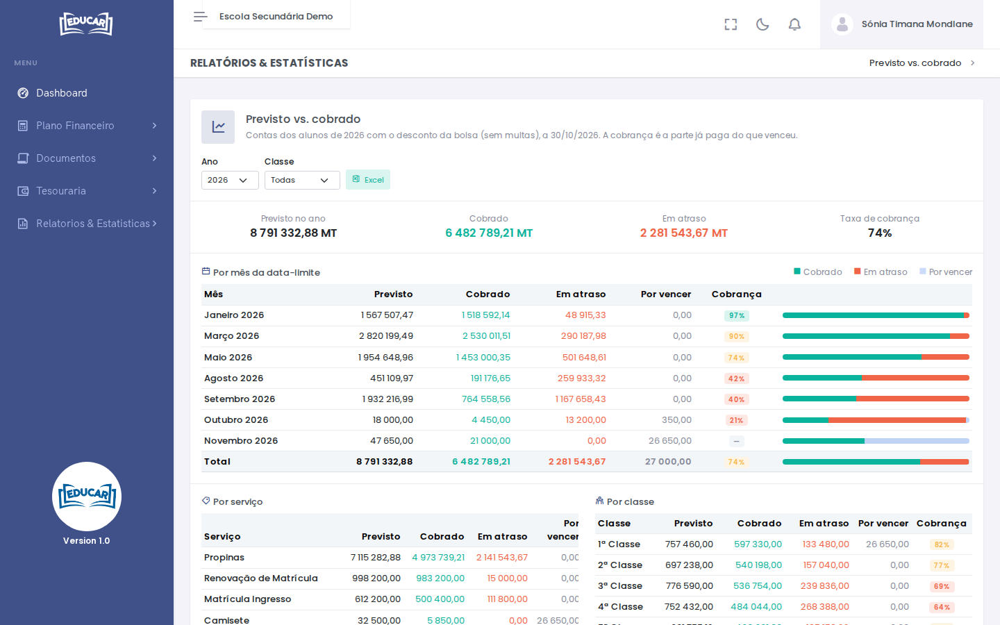

# Previsto vs Cobrado

**Menu:** Relatórios e Estatísticas › Previsto vs Cobrado
**Quem vê:** Director da escola, Director financeiro

Quanto a escola devia receber no ano, quanto já recebeu e quanto está em atraso. A conta é feita com as contas dos alunos, com o desconto da bolsa e sem as multas. A **Taxa de cobrança** é a parte já paga do que já venceu.

## Ler o relatório

Escolha o **Ano** e, se quiser, a **Classe**.

- No topo: o **Previsto no ano**, o **Cobrado**, o que está **Em atraso** e a **Taxa de cobrança**.
- **Por mês da data-limite**: para cada mês, o previsto, o cobrado, o que está em atraso e o que está **Por vencer**. Mostra os meses em que a cobrança correu pior.
- **Por serviço**: propinas, matrícula, renovação, taxas de exame, documentos, cobranças…
- **Por classe**: as classes com mais atraso.

**Excel** descarrega o relatório com os mesmos filtros.

Para saber quem deve, use [Devedores](devedores.md).
