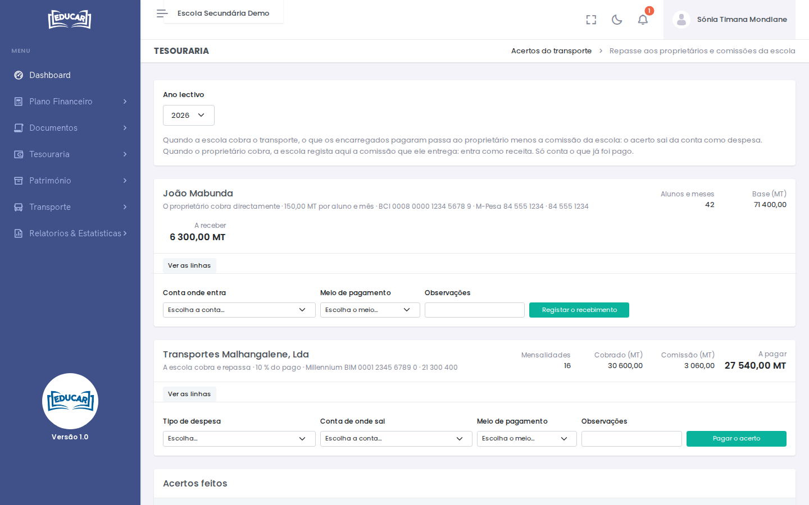
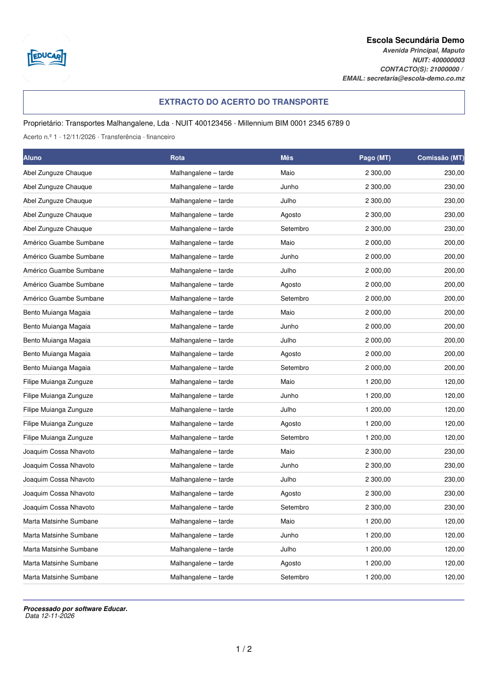

# Acertos do transporte

**Menu:** Tesouraria › Acertos do transporte
**Quem vê:** Director financeiro, Funcionário das finanças

O dinheiro do transporte com os proprietários das carrinhas, conforme o [acordo do ano](../transporte/acordos.md). Só conta o que já foi pago.

## Pagar ao proprietário (a escola cobra e repassa)

Para cada proprietário aparecem as mensalidades pagas ainda não acertadas: o total cobrado, a comissão da escola e o valor **A pagar**. **Ver as linhas** mostra o aluno, a rota e o mês de cada mensalidade.

1. Escolha o **Tipo de despesa**, a **Conta de onde sai** e o **Meio de pagamento**.
2. Escreva uma observação, se quiser (por exemplo o período).
3. Use **Pagar o acerto** e confirme.

O valor sai da conta como despesa e fica em [Receitas e Despesas](receitas-e-despesas.md). As mensalidades acertadas não voltam a contar.

Se uma mensalidade já acertada deixar de estar paga (pagamento anulado), entra no acerto seguinte como desconto. Se o total ficar negativo, não há nada a pagar até haver mais mensalidades pagas.

## Receber a comissão (o proprietário cobra directamente)

A comissão conta-se por aluno e mês, até ao mês corrente, sobre o preço da inscrição. Escolha a **Conta onde entra** e o **Meio de pagamento** e use **Registar o recebimento**. O valor entra na conta como receita, no serviço "Transporte escolar".

## Extracto

Em **Acertos feitos**, **Extracto** imprime o acerto para o proprietário: os alunos e os meses, a comissão, o total e o espaço para as duas assinaturas.

## Avisos

A partir do **Dia do acerto** de cada acordo, as finanças recebem um aviso uma vez por mês, quando há alguma coisa por pagar ou por receber.
