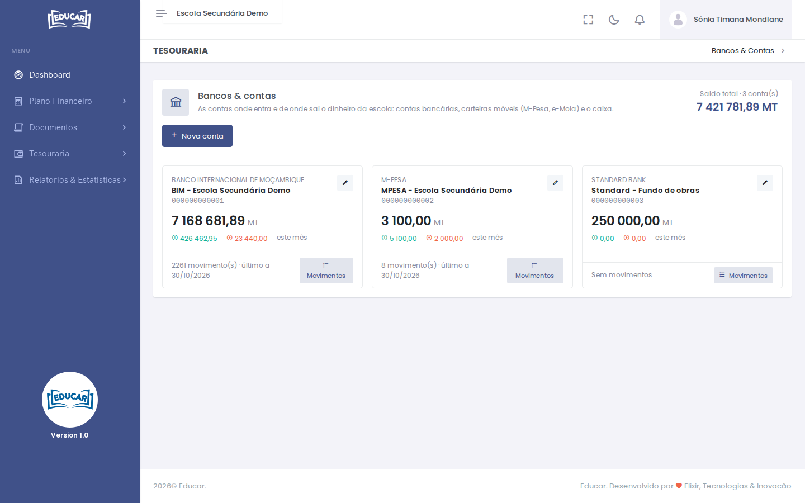

# Bancos & Contas

**Menu:** Tesouraria › Bancos & Contas
**Quem vê:** Director financeiro, Funcionário das finanças

As contas da escola, ou seja, onde entra e de onde sai o dinheiro: contas bancárias, carteiras móveis (M-Pesa, e-Mola) e o caixa. A escola pode ter várias contas do mesmo banco.

Cada cartão mostra o saldo da conta, o que entrou e saiu este mês e o último movimento. No topo fica o saldo de todas as contas.

## Registar uma conta

1. Use **Nova conta**.
2. Escolha o **Banco / carteira**.
3. Escreva o **Número da conta** e uma **Descrição** que distinga a conta, por exemplo `BCI - Propinas` ou `Standard - Fundo de obras`.
4. Em **Saldo actual (MT)**, escreva o saldo que a conta já tem hoje.
5. Use **Registar conta**.

Depois de registada, o saldo da conta só muda com os movimentos: pagamentos, vendas, despesas e transferências.

## Corrigir uma conta

O lápis do cartão corrige o número ou a descrição. O saldo não se corrige aqui.

## Ver os movimentos

**Movimentos** abre [Receitas e Despesas](receitas-e-despesas.md) só com os movimentos dessa conta.
