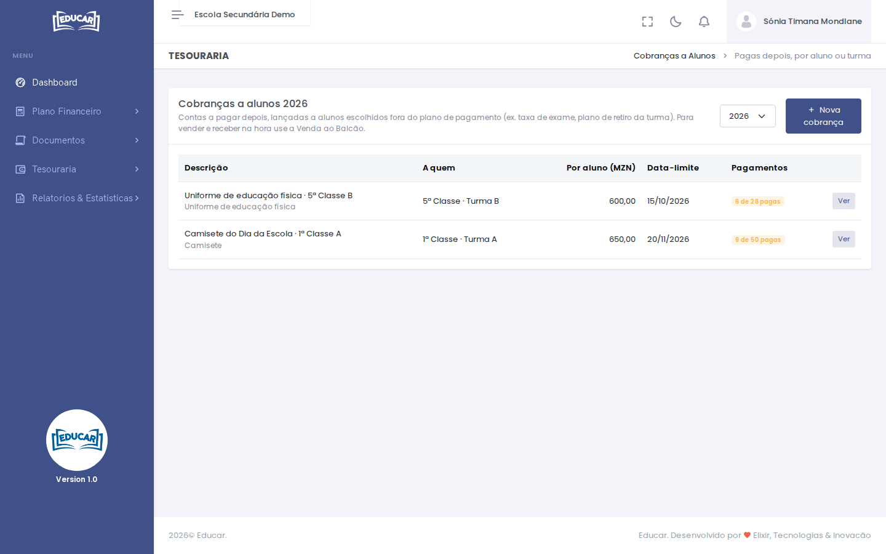
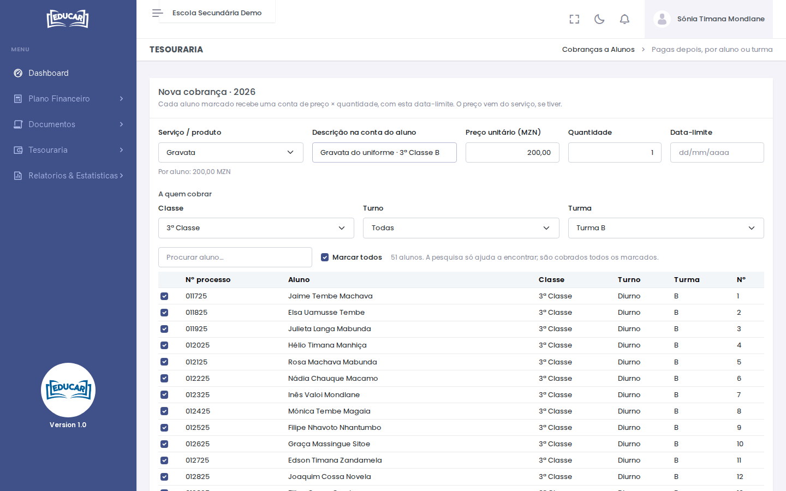
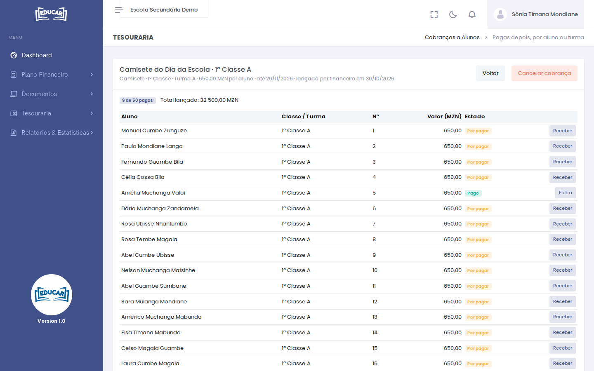

# Cobranças a Alunos

**Menu:** Tesouraria › Cobranças a Alunos
**Quem vê:** Director financeiro, Funcionário das finanças

Uma conta que os alunos pagam depois e que não está no plano de pagamento da classe. Por exemplo, a camisete do Dia da Escola de uma turma, o uniforme de educação física ou o plano de retiro de uma turma. Cada aluno escolhido fica com a conta na ficha, por pagar até à data-limite.

Para vender e receber na hora, use [Venda ao Balcão](venda-ao-balcao.md).

A lista mostra as cobranças do ano escolhido no canto superior direito: a quem se cobra, o valor por aluno, a data-limite e quantos já pagaram.

## Lançar uma cobrança

1. Use **Nova cobrança**.
2. Escolha o **Serviço / produto**. O preço vem de [Serviços e Preços](../plano-financeiro/servicos-e-precos.md), se tiver. Pode mudá-lo.
3. Escreva a **Descrição na conta do aluno**, por exemplo `Camisete do Dia da Escola · 1ª Classe A`, a **Quantidade** e a **Data-limite**.
4. Em **A quem cobrar**, escolha a classe, o turno e a turma. Os alunos dessa escolha vêm marcados. Pode desmarcar alguns ou marcar outros à mão. **Procurar aluno** só ajuda a encontrar um nome na lista: são cobrados todos os marcados.
5. Por baixo vê quantos alunos estão marcados e o total. Use **Lançar cobrança** e confirme.

!!! note "Toda a escola"
    Sem classe nem turma escolhidas, a lista mostra todos os alunos da escola, mas nenhum vem marcado. Assim, uma cobrança à escola inteira só se faz de propósito, com **Marcar todos**.

## Acompanhar e receber

**Ver** abre a cobrança, com cada aluno e o estado da conta: **Pago** ou **Por pagar**.

- **Receber** abre as contas por pagar do aluno, para registar o pagamento como qualquer outra conta. Veja [Registar um pagamento](../matricula-e-turmas/pesquisar-turma.md#registar-um-pagamento).
- **Ficha** abre a ficha do aluno que já pagou.

Depois da data-limite, as contas por pagar entram em [Devedores](../relatorios-e-estatisticas/devedores.md) e pagam a multa da [Tabela de Multas](../plano-financeiro/tabela-de-multas.md), se houver.

## Cancelar uma cobrança

Na cobrança, use **Cancelar cobrança**. As contas ainda por pagar desaparecem das fichas dos alunos. As que já foram pagas mantêm-se.
