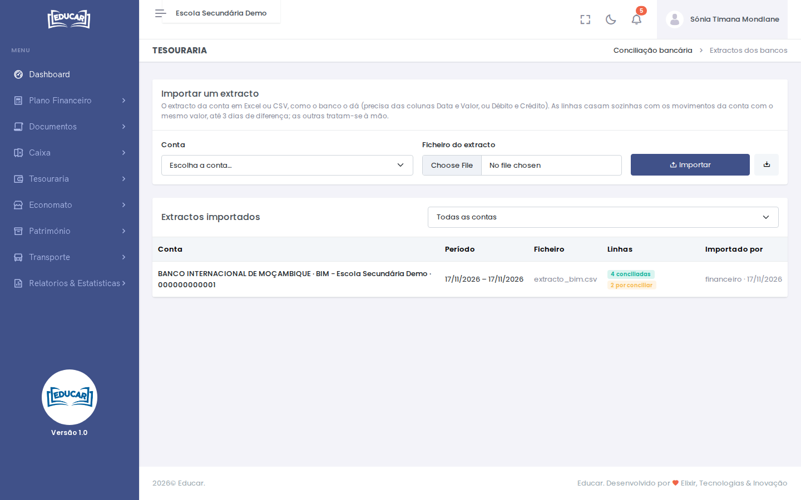
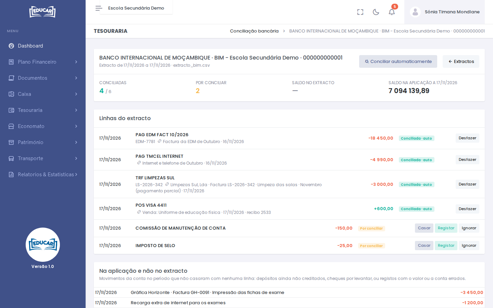

# Conciliação bancária

**Menu:** Tesouraria › Conciliação bancária
**Quem vê:** Director financeiro, Funcionário das finanças

Para confirmar que o que está registado em cada conta bate com o extracto do banco: as linhas do extracto casam com os movimentos da conta, e o que sobra de um lado ou do outro fica à vista.

## Importar o extracto

1. Peça ao banco (ou descarregue do serviço online) o extracto da conta em **Excel (.xlsx)** ou **CSV**.
2. Escolha a **Conta** e o **Ficheiro do extracto** e use **Importar**.

O extracto precisa de uma coluna **Data** e de **Valor** (com sinal) ou **Débito** e **Crédito**; a **Descrição**, a **Referência** e o **Saldo** são opcionais. Os nomes das colunas reconhecem-se como os bancos os escrevem (por exemplo `Data Mov.`, `Descritivo`, `Débito`). Se o banco der outro formato, copie as linhas para o **modelo** (o botão ao lado de **Importar**).

As linhas que já estavam num extracto importado antes, da mesma conta, não se repetem: pode importar extractos que se sobrepõem.

## Conciliar

Ao importar, cada linha casa sozinha com um movimento da conta com o **mesmo valor e sentido**, até **3 dias** de diferença (fica **Conciliada · auto**). Se houver vários movimentos iguais, a linha fica **Por conciliar**, para escolher à mão. Para cada linha por conciliar:

- **Casar:** mostra os movimentos da conta com o mesmo valor até 15 dias de diferença; escolha o certo.
- **Registar:** para o que só está no banco, como a comissão de manutenção ou juros. Escolha o tipo de despesa (ou de receita) e use **Registar e conciliar**: o movimento entra na conta com a data da linha. Com o [orçamento](../plano-financeiro/orcamento.md) aprovado, uma despesa acima do disponível só o director financeiro a regista.
- **Ignorar:** com o motivo, para o que não se regista na aplicação.

**Desfazer** volta a pôr a linha por conciliar. **Conciliar automaticamente** tenta de novo as linhas que faltam (por exemplo, depois de registar um pagamento esquecido).

## O que conferir

- **Saldo no extracto** e **Saldo na aplicação** no último dia do extracto: uma diferença aparece a vermelho.
- **Na aplicação e não no extracto:** os movimentos da conta no período que não casaram com nenhuma linha. Podem ser depósitos ainda não creditados, cheques por levantar, ou registos com o valor ou a conta errados.
