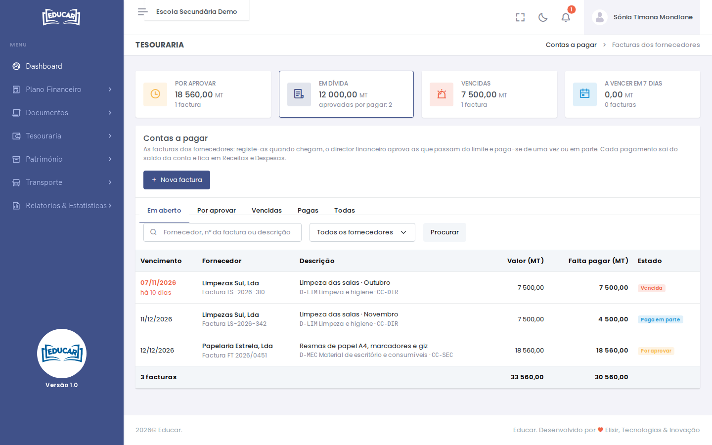
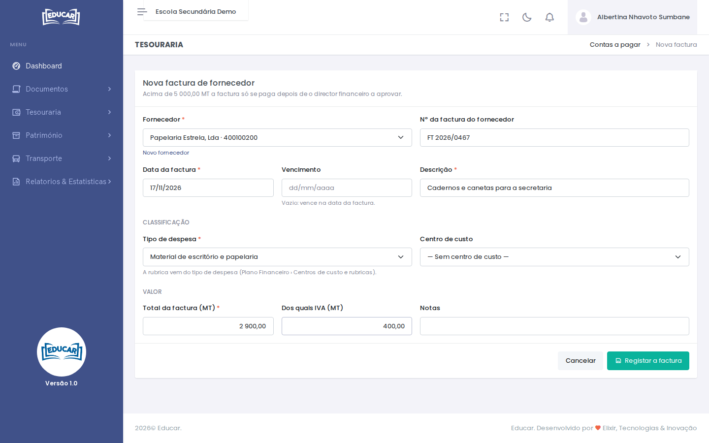
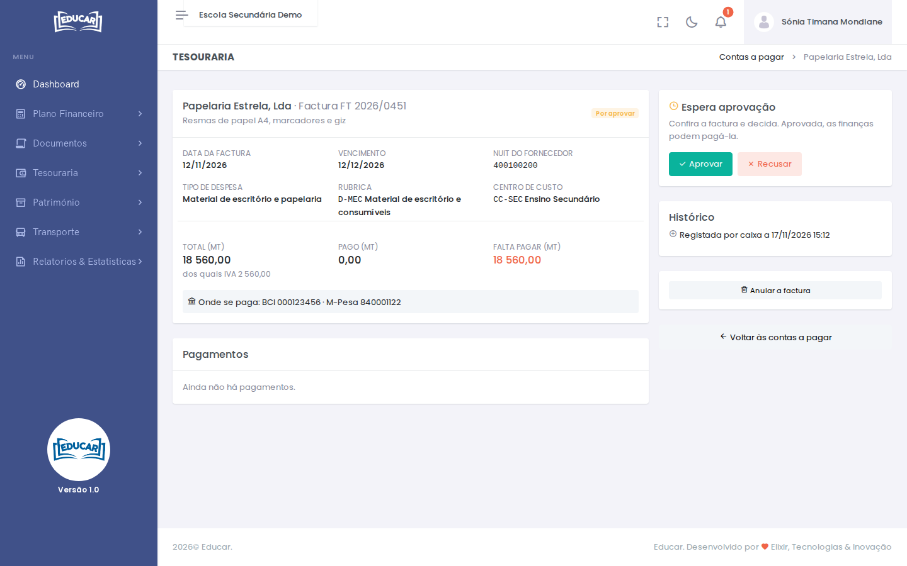
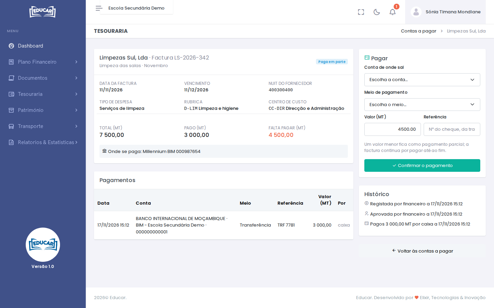

# Contas a pagar

**Menu:** Tesouraria › Contas a pagar
**Quem vê:** Director financeiro, Funcionário das finanças

As facturas dos fornecedores: o que a escola deve, a quem e quando vence. As finanças registam a factura quando chega; o director financeiro aprova as que passam do limite; depois paga-se de uma vez ou em parte. Cada pagamento sai do saldo da conta e entra em [Receitas e Despesas](receitas-e-despesas.md).

## O topo da lista

- **Por aprovar:** as facturas à espera do director financeiro.
- **Em dívida:** o que falta pagar das facturas aprovadas.
- **Vencidas:** as aprovadas por pagar cujo vencimento já passou.
- **A vencer em 7 dias:** as aprovadas que vencem na próxima semana.

Cada cartão abre a lista correspondente. Os separadores **Em aberto**, **Por aprovar**, **Vencidas**, **Pagas** e **Todas** mudam a lista; procure pelo fornecedor, pelo número da factura ou pela descrição, ou escolha um fornecedor. Clique numa factura para abrir a ficha.

## Registar uma factura

1. Use **Nova factura**.
2. Escolha o **Fornecedor**. Se ainda não existe, registe-o em [Fornecedores](fornecedores.md).
3. Escreva o **Nº da factura do fornecedor**, a **Data da factura** e o **Vencimento**. Sem vencimento, a factura vence na data da factura.
4. Escreva a **Descrição**: o que se comprou.
5. Escolha o **Tipo de despesa** e, se quiser, o **Centro de custo**. A rubrica vem do tipo de despesa, como está em [Centros de custo e rubricas](../plano-financeiro/centros-de-custo-e-rubricas.md#rubrica-de-cada-servico).
6. Escreva o **Total da factura (MT)** e, se a factura o mostra, quanto é **IVA**.
7. Use **Registar a factura**.

A mesma factura do mesmo fornecedor não se regista duas vezes.

## Aprovação

Na [Definição financeira](../plano-financeiro/definicao-financeira.md#facturas-de-fornecedores), o director financeiro diz a partir de que valor uma factura precisa da sua aprovação:

- uma factura até ao limite fica logo aprovada;
- uma factura acima do limite fica **Por aprovar**, e o director financeiro recebe um aviso no sino;
- uma factura registada pelo próprio director financeiro fica logo aprovada.

Sem limite, todas as facturas registadas pelo funcionário das finanças esperam aprovação.

O director financeiro abre a factura e usa **Aprovar**, ou **Recusar** com o motivo. Em ambos os casos, as finanças recebem um aviso. Uma factura recusada não se paga.

## Pagar

Na ficha de uma factura aprovada:

1. Escolha a **Conta de onde sai** o dinheiro e o **Meio de pagamento**.
2. O **Valor** vem com o que falta pagar. Para pagar só uma parte, escreva um valor menor.
3. Se quiser, escreva a **Referência**, por exemplo o número do cheque ou da transferência.
4. Use **Confirmar o pagamento**.

Com um pagamento parcial, a factura fica **Paga em parte** e continua na dívida até ao fim. Paga por inteiro, fica **Paga**. Os pagamentos e o **Histórico** ficam na ficha: quem registou, quem aprovou, quem pagou e quando. Por baixo da factura aparece onde se paga ao fornecedor (banco, NIB, carteira).

## Vencimentos

As finanças recebem um aviso no sino três dias antes do vencimento de uma factura aprovada por pagar, e outro quando ela vence. Cada aviso segue uma vez.

## Anular

Uma factura em aberto e sem pagamentos anula-se na ficha, com **Anular a factura** e o motivo (por exemplo, registada em duplicado). Fica **Anulada** e deixa de contar na dívida.

## Facturas de despesas do património

Quando o fornecedor de uma compra ou reparação do património manda factura para pagar mais tarde, use **Registar a factura** em [Despesas do Património](despesas-do-patrimonio.md). A factura vem preenchida com a descrição e o valor e, se o nome escrito pelo gestor for o de um fornecedor da escola, com o fornecedor. A despesa passa a mostrar **Em contas a pagar**; paga a factura, fica paga lá também. Se a factura for anulada, a despesa volta a ficar por pagar.
