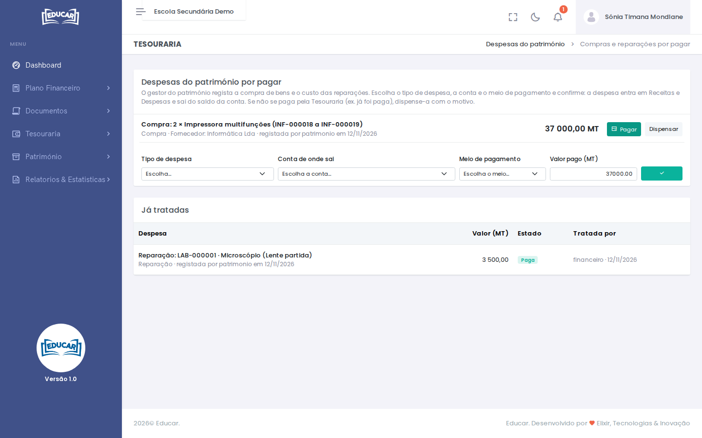

# Despesas do Património

**Menu:** Tesouraria › Despesas do Património
**Quem vê:** Director financeiro, Funcionário das finanças

As compras de bens e o custo das reparações registados pelo gestor do património, à espera de pagamento. O gestor diz o que se comprou ou reparou e quanto custou; as finanças escolhem de que conta sai o dinheiro e pagam. O saldo da conta só muda quando as finanças pagam.

## De onde vêm

- **Compra:** ao [registar um bem](../patrimonio/registar-bem.md) com origem **Compra** e com valor, a opção **Lançar a compra na Tesouraria** cria a despesa: o valor unitário vezes a quantidade. Vários bens iguais dão uma só despesa, por exemplo `Compra: 2 × Impressora multifunções (INF-000018 a INF-000019)`.
- **Reparação:** ao concluir uma [reparação](../patrimonio/avarias-e-reparacoes.md#concluir) com custo, a opção **Lançar o custo na Tesouraria** cria a despesa.

As finanças recebem um aviso no sino com cada despesa nova.

## Pagar

1. Na despesa, use **Pagar**.
2. Escolha o **Tipo de despesa**. Os tipos são as despesas de [Serviços e Preços](../plano-financeiro/servicos-e-precos.md).
3. Escolha a **Conta de onde sai** o dinheiro e o **Meio de pagamento**.
4. Confirme o **Valor pago (MT)**. Vem o valor registado pelo gestor; se a factura for diferente, corrija-o.
5. Use o botão verde para confirmar.

A despesa entra em [Receitas e Despesas](receitas-e-despesas.md), com a descrição da compra ou da reparação e o fornecedor, e sai do saldo da conta. Na ficha do bem, o quadro **Tesouraria** passa a mostrar a despesa como **Paga**, com quem a pagou e quando.

## Dispensar

Use **Dispensar** quando a despesa não se paga pela Tesouraria, por exemplo porque já foi paga antes ou foi paga por outra entidade. Escreva o motivo e use **Dispensar a despesa**. O saldo não muda.

## Já tratadas

**Mostrar** abre as despesas pagas, dispensadas e anuladas, com o valor, o motivo e quem as tratou.

Uma compra fica **Anulada** quando o gestor anula o registo de todos os bens dessa compra antes de ela ser paga. Se anular só alguns, a despesa baixa o valor desses bens.
