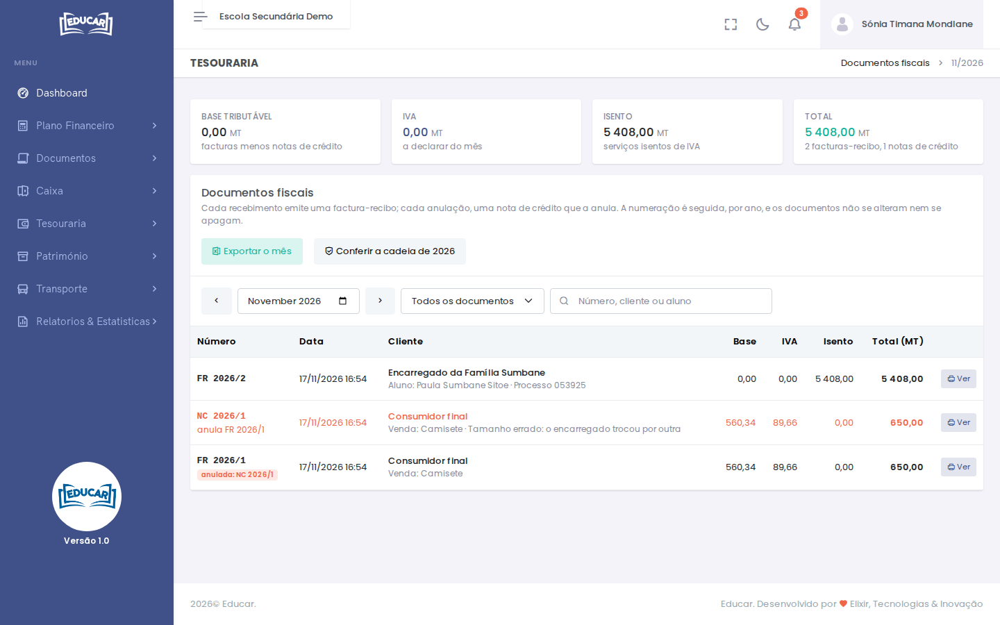
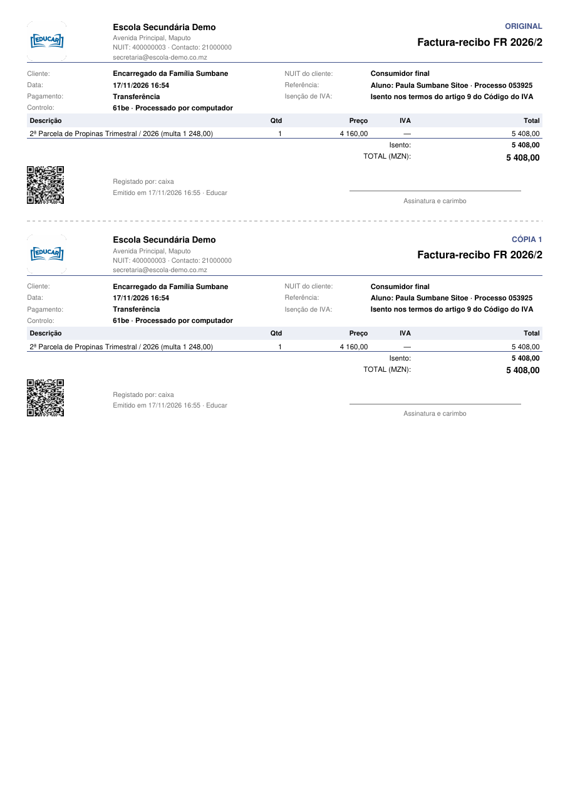

# Documentos fiscais

**Menu:** Tesouraria › Documentos fiscais
**Quem vê:** Director financeiro, Funcionário das finanças

Nas escolas **privadas** (veja [Definição financeira](../plano-financeiro/definicao-financeira.md#iva-escola-privada)), cada recebimento emite um documento fiscal em vez do recibo simples. As escolas públicas continuam com o recibo.

## Quando se emitem

- **Factura-recibo (FR):** sai sozinha em cada recebimento: o pagamento das contas de um aluno, uma [venda ao balcão](venda-ao-balcao.md) e uma receita em [Receitas e Despesas](receitas-e-despesas.md). Os botões de recibo (na ficha do aluno, na venda e na app) passam a mostrar a factura-recibo.
- **Nota de crédito (NC):** sai sozinha quando se anula um recebimento com factura-recibo (anular o pagamento na ficha do aluno ou a venda), com o motivo. A factura-recibo fica, marcada como anulada pela nota de crédito.

Os documentos não se alteram nem se apagam. A numeração é seguida por tipo e por ano (FR 2026/1, FR 2026/2…; NC 2026/1…).

## O que mostram

- a escola (nome, NUIT, morada e contacto) e o número do documento;
- o **cliente**: o encarregado do aluno (ou o aluno), ou **Consumidor final** numa venda; a referência (o aluno e o número de processo, ou a venda);
- uma linha por conta ou produto, com o desconto e a multa, a taxa de IVA e o total;
- o **Isento**, a **Base tributável**, o **IVA** e o **TOTAL**; nos serviços isentos, o motivo da isenção;
- o **Controlo**: 4 caracteres do código de segurança do documento.

## O IVA

O IVA segue a Definição financeira: a taxa, se os preços já o incluem ou se se acrescenta, e o **IVA de cada serviço** (por omissão, os produtos pagam IVA e os serviços de ensino são isentos).

Com o IVA **acrescido aos preços**, o valor a pagar já o leva: na ficha do aluno cada conta mostra "com IVA" e o total, e nas vendas o preço dos produtos inclui o IVA. A app e o relatório de [Devedores](../relatorios-e-estatisticas/devedores.md) mostram o mesmo valor.

## A lista do mês

Escolha o mês (ou use as setas), o tipo de documento, ou procure pelo número, pelo cliente ou pelo aluno. Em cima, o mapa do IVA do mês: **Base tributável**, **IVA** (a declarar), **Isento** e **Total**, com as notas de crédito já descontadas. **Ver** abre o documento para imprimir.

- **Exportar o mês** descarrega uma folha de Excel com todos os documentos do mês e os totais, para o contabilista (as notas de crédito vêm a negativo).
- **Conferir a cadeia** verifica que os documentos do ano estão como foram emitidos: cada um guarda o código do anterior, e qualquer alteração fora da aplicação quebra a cadeia. Se aparecer um aviso, contacte a ELIXIR.
