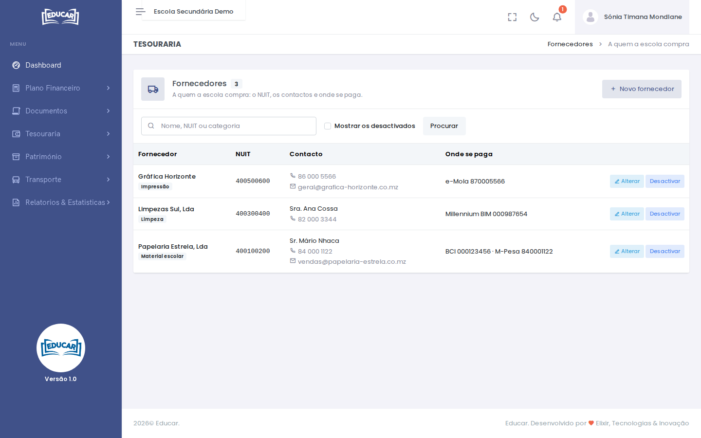

# Fornecedores

**Menu:** Tesouraria › Fornecedores
**Quem vê:** Director financeiro, Funcionário das finanças

As empresas e as pessoas a quem a escola compra: o NUIT, os contactos e onde se lhes paga.

## Registar um fornecedor

1. Use **Novo fornecedor**.
2. Escreva o **Nome**. O **NUIT** (9 algarismos) e a **Categoria** são opcionais; a categoria sugere as que a escola já usa, por exemplo `Material escolar` ou `Limpeza`.
3. Em **Contacto**, a pessoa de contacto, o telefone, o email e a morada.
4. Em **Onde se paga**, o banco e o número da conta, o NIB e a carteira móvel (M-Pesa, e-Mola).
5. Use **Gravar fornecedor**.

O mesmo NUIT não se repete na escola. Para corrigir os dados, use **Alterar**.

## Procurar e desactivar

Procure pelo nome, pelo NUIT ou pela categoria. Um fornecedor com quem a escola deixou de trabalhar não se apaga: use **Desactivar**. Deixa de aparecer nas escolhas, mas o histórico fica. **Mostrar os desactivados** volta a mostrá-los, com **Activar**.
