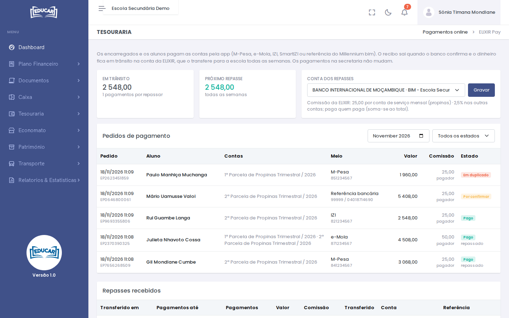
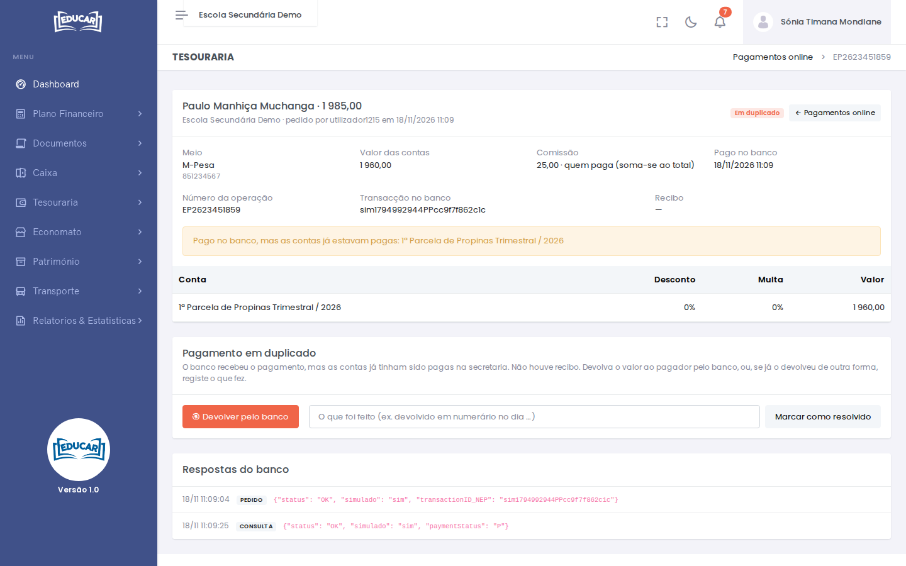

# Pagamentos online

**Menu:** Tesouraria › Pagamentos online
**Quem vê:** Director financeiro, Funcionário das finanças

Com o ELIXIR Pay, os encarregados e os alunos pagam as contas na app EDUCAR: por M-Pesa, e-Mola, IZI, SmartIZI (código QR) ou por referência de pagamento do Millennium bim. Os pagamentos na secretaria continuam iguais.

A ELIXIR liga o ELIXIR Pay a pedido da escola e combina a comissão: um valor fixo por propina e uma percentagem nas outras contas. A comissão pode somar-se ao que o encarregado paga ou ser descontada à escola no repasse.

## Como funciona

1. Na app, o encarregado escolhe as contas e o meio de pagamento. O valor de cada conta (com o desconto e a multa desse dia) fica no pedido.
2. O banco envia o pedido de confirmação para o telemóvel (M-Pesa, e-Mola, IZI) ou mostra o código QR ou a referência. O pedido fica **Por confirmar**.
3. Quando o banco confirma o pagamento, o recibo sai sozinho, como os da secretaria (feito por **ELIXIR Pay**), e o encarregado recebe o aviso. Numa escola privada sai a factura-recibo.
4. O dinheiro entra na conta da ELIXIR. Na escola, os recibos ficam na conta **ELIXIR Pay (em trânsito)**, que aparece em [Bancos & Contas](bancos-contas.md) e não se escolhe nos outros formulários.
5. Todas as semanas, a ELIXIR transfere para a conta da escola o que está em trânsito e regista o repasse: o valor sai da conta em trânsito para a conta dos repasses e a escola recebe o aviso. Se a comissão é da escola, fica a despesa **Comissões ELIXIR Pay**.

Um pedido que o encarregado não confirma expira: o push no fim do dia e a referência depois do prazo (3 dias). As contas continuam por pagar.

## A conta dos repasses

O director financeiro escolhe, em **Conta dos repasses**, a conta da escola onde chegam as transferências semanais, e usa **Gravar**. Sem conta escolhida, a ELIXIR não consegue registar o repasse.

No topo da página:

- **Em trânsito**: os pagamentos confirmados que ainda não foram transferidos.
- **Próximo repasse**: o que a escola vai receber (o valor em trânsito, menos a comissão quando é a escola que a paga).

Em **Repasses recebidos** ficam as transferências da ELIXIR, com a referência no banco, para conferir no extracto (veja [Conciliação bancária](conciliacao-bancaria.md)).

## Os pedidos

A lista mostra os pedidos do mês, com o aluno, as contas, o meio, o valor e a comissão. Escolha outro mês ou um estado para filtrar. Clique num pedido para ver as contas, o recibo e as respostas do banco.

| Estado | Quer dizer |
|---|---|
| **Por confirmar** | O banco ainda não confirmou o pagamento |
| **Pago** | O banco confirmou e o recibo saiu |
| **Em duplicado** | O banco recebeu, mas as contas já tinham sido pagas na secretaria |
| **Devolvido** / **Resolvido** | O duplicado foi devolvido ao pagador |
| **Rejeitado**, **Expirado**, **Cancelado** | Não houve pagamento |
| **Não enviado** | O banco não aceitou o pedido |

Se o banco confirma um pagamento mas o recibo não pode sair (por exemplo, a renovação de matrícula com o ano lectivo seguinte por preparar), as finanças recebem um aviso com o motivo. Resolva a causa: o recibo sai sozinho na tentativa seguinte, de meia em meia hora.

## Pagamentos em duplicado

Enquanto um pedido está por confirmar, a ficha do aluno mostra, na conta, a etiqueta **pagamento pela app por confirmar**. A secretaria pode receber a conta na mesma (por exemplo, se o encarregado desistiu do pagamento na app). Se o banco depois confirmar o pagamento da app, não há recibo: o pedido fica **Em duplicado** e o director financeiro recebe o aviso.

O director financeiro abre o pedido e:

- **Devolver pelo banco**: o banco devolve o valor ao pagador (M-Pesa, e-Mola, IZI e SmartIZI). O pedido fica **Devolvido**.
- **Marcar como resolvido**: para os pagamentos por referência, ou quando o valor já foi devolvido de outra forma. Escreva o que foi feito.
